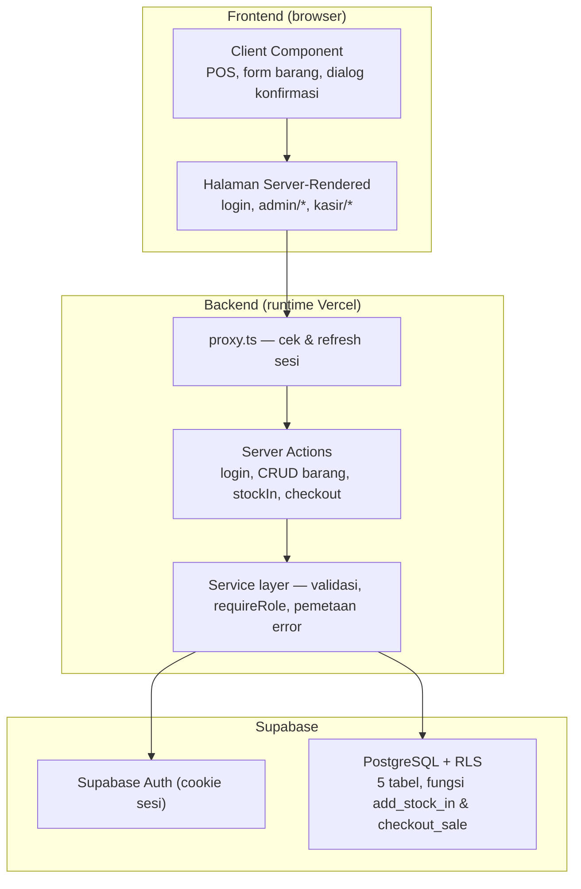

# STOKITA — Sistem Informasi Manajemen Stok dan Penjualan Barang

Aplikasi web manajemen stok dan penjualan untuk UMKM: pengelolaan barang,
pencatatan barang masuk, monitoring stok menipis/habis, transaksi penjualan
(Point of Sale) oleh kasir, serta riwayat transaksi — dengan keamanan berlapis
(RLS, otorisasi role, fungsi transaksi database atomik).

## 📚 Tugas Mata Kuliah: Analisis & Pengujian Sistem IF7A

- **Mata Kuliah:** Analisis & Pengujian Sistem
- **Kelas:** IF7A
- **Judul:** STOKITA — Sistem Informasi Manajemen Stok dan Penjualan Barang

**Ketua Kelompok:** JIHAN GALUH PUTRI — 23EO10034

**Anggota:**

- NIA AMELIA — 23EO10035
- ZAKIYATURROHMAH — 23EO10014
- ERSA KINANTI APRILLIA — 23EO10040
- EMALIA NURHAYATI — 23E010046

## 📝 Deskripsi Proyek (20 poin)

Repositori ini berisi artefak, dokumen, dan kode yang berkaitan dengan tugas
mata kuliah Analisis & Pengujian Sistem. Proyek ini bertujuan menganalisis
kebutuhan, merancang arsitektur, dan mengimplementasikan sistem stok dan
penjualan STOKITA beserta pengujian fungsionalnya.

Latar belakang dan tujuan:

1. UMKM membutuhkan pencatatan stok dan penjualan yang akurat agar tidak
   terjadi kehabisan barang, selisih kas, atau hilangnya riwayat transaksi.
2. Menjaga data barang, stok, dan transaksi tetap konsisten — perubahan stok
   hanya melalui fungsi database transaksional (`add_stock_in`,
   `checkout_sale`), bukan editan bebas.
3. Memisahkan hak akses **admin** (pengelolaan persediaan) dan **kasir**
   (penjualan) di setiap lapisan: halaman, Server Action, dan Row Level
   Security database.
4. Menyediakan riwayat penjualan dan pergerakan stok yang dapat ditelusuri
   sebagai dasar pengujian sistem.

Fitur utama:

| Aktor | Kemampuan |
| --- | --- |
| **Admin** (`/admin`) | Dashboard penjualan hari ini, kelola barang (tambah/edit/nonaktif-aktif/hapus dengan konfirmasi), barang masuk, monitoring stok menipis/habis, riwayat mutasi stok, riwayat penjualan seluruh kasir + filter tanggal |
| **Kasir** (`/kasir`) | Penjualan POS: cari barang aktif, keranjang, kuantitas, bayar TUNAI/NON_TUNAI, konfirmasi, struk digital, transaksi baru; riwayat transaksi miliknya sendiri |

Tidak ada registrasi publik: akun dibuat lewat `npm run seed:accounts`
(admin API Supabase Auth) → `admin`, `kasir1`, `kasir2`.

## 📝 Desain Proyek (Unified Modeling System) (20 poin)

Desain sistem didokumentasikan dengan diagram Use Case, Sequence Diagram, dan
Activity Diagram (Mermaid) pada folder [`docs/uml/`](docs/uml/):

| Diagram | File | Isi singkat |
| --- | --- | --- |
| **Use Case** | [`docs/uml/use-case.md`](docs/uml/use-case.md) | Aktor admin (UC-A1–A15) dan kasir (UC-K1–K9), hubungan `«include»`/`«extend»`, serta kaitan ke Supabase (RLS & fungsi transaksi) |
| **Sequence — Login** | [`docs/uml/sequence-login.md`](docs/uml/sequence-login.md) | Form login → Server Action `login` → Supabase Auth (`signInWithPassword`) → cek profil `profiles` → redirect per role; termasuk cabang gagal (kredensial salah, profil tidak valid) dan proteksi `proxy.ts` |
| **Sequence — Penjualan** | [`docs/uml/sequence-penjualan.md`](docs/uml/sequence-penjualan.md) | Kasir → `checkoutAction` → `checkoutSale` → fungsi PostgreSQL `checkout_sale`: kunci baris `FOR UPDATE`, cek aktif/stok, hitung total di DB, tulis `sales` + `sale_items` + kurangi stok + mutasi OUT secara atomik → struk |
| **Activity — Penjualan** | [`docs/uml/activity-penjualan.md`](docs/uml/activity-penjualan.md) | Alur aktivitas POS dari keranjang sampai struk, termasuk seluruh percabangan gagal: `CT001–CT003` (input/barang), `PY001–PY003` (bayar), `ST001` (stok kurang), transaksi gagal → rollback |

Penjelasan naratif per use case (prasyarat, hasil, hak akses) ada di
[`docs/USE_CASE_AND_FLOW.md`](docs/USE_CASE_AND_FLOW.md).

## 📝 Arsitektur Proyek (Unified Modeling System) (20 poin)

Secara umum STOKITA adalah aplikasi **Next.js App Router** yang berjalan di
Vercel dan memakai **Supabase** (Auth + PostgreSQL) sebagai backend; tidak
memiliki REST API route buatan sendiri — seluruh baca/tulis data melalui
Server Component, Server Action, dan fungsi transaksi database.



- **Lapis keamanan:** `proxy.ts` (sesi) → layout `requireRole` per halaman →
  `requireRole` di Server Action/service → RLS + grant minimal database.
- **Konsistensi data:** stok & transaksi hanya lewat fungsi SECURITY DEFINER
  dengan row locking `FOR UPDATE` dan transaksi penuh (gagal = rollback).
- Dokumen lengkap: [`docs/ARCHITECTURE.md`](docs/ARCHITECTURE.md) dan
  diagram runtime [`docs/uml/arsitektur-sistem.md`](docs/uml/arsitektur-sistem.md).

## 📝 Tech Stack (20 poin)

| Bagian | Teknologi | Versi / Keterangan |
| --- | --- | --- |
| **FE:** | Next.js (App Router, Turbopack), React, TypeScript, CSS custom Stokita | Next.js `^16.4.0`, React `^19.3.0`, TypeScript `^5.9.3` |
| **BE:** | Next.js Server Component + Server Actions (tanpa REST API terpisah), service layer TypeScript, validasi server-side, ESLint | ESLint `^9.39.5`, `eslint-config-next ^16.4.0` |
| **Database:** | PostgreSQL (Supabase) — Row Level Security, fungsi transaksional `add_stock_in` & `checkout_sale`, 5 tabel + sequence, migrasi SQL 001–005 | `@supabase/supabase-js ^2.117.3`, `@supabase/ssr ^0.12.7` |
| **Service:** | Supabase (Auth, Database, PostgREST), Vercel (build & hosting), GitHub (repositori) | Deploy: https://stokita-taupe.vercel.app |

Prasyarat lokal: Node.js 20.9+ (dikembangkan dengan Node 22) dan npm 11+.

## 📝 Upload Project masing-masing di Github dan demonstrasikan pada waktu UTS (20 poin)

- **Repository GitHub:** https://github.com/JihanGaluhPutri/STOKITA.git
  (kode, dokumentasi, dan migrasi SQL terunggah pada branch `main`).
- **Deployment (live):** https://stokita-taupe.vercel.app — siap didemonstrasikan
  pada waktu UTS: login admin/kasir, kelola barang, barang masuk, transaksi POS
  + struk, riwayat.
- **Bukti pengunggahan:** commit `688f522` (109 file: source `src/`, migrasi
  `supabase/`, dokumentasi `docs/` + `docs/uml/`, README).
- Pastikan setiap anggota mengunggah/push porsinya ke repository kelompok ini
  sebelum sesi demonstrasi.

---

## Panduan Menjalankan Lokal

1. `npm install`
2. Salin `.env.example` menjadi `.env.local` lalu isi nilai dari dashboard
   Supabase (Settings → API).
3. Terapkan migrasi `supabase/migrations/001`–`005` secara berurutan
   (lihat `supabase/README.md`).
4. Buat akun awal: isi `STOKITA_*_PASSWORD` di `.env.local`, lalu
   `npm run seed:accounts`.
5. (Opsional, untuk demonstrasi) Seed data contoh:
   `supabase/seed/seed_products.sql`, lalu `supabase/seed/seed_transactions.sql`.
6. `npm run dev` → buka http://localhost:3000

| Perintah | Fungsi |
| --- | --- |
| `npm run dev` | server development |
| `npm run build` | build production |
| `npm run start` | jalankan build production |
| `npm run typecheck` | pemeriksaan TypeScript (`tsc --noEmit`) |
| `npm run lint` | ESLint |
| `npm run seed:accounts` | buat/selaraskan 1 admin + 2 kasir via Supabase Auth (idempoten) |

### Variabel Lingkungan

| Nama | Development | Production | Keterangan |
| --- | --- | --- | --- |
| `NEXT_PUBLIC_SUPABASE_URL` | `.env.local` | Dashboard Vercel | URL proyek Supabase — dipakai browser & server |
| `NEXT_PUBLIC_SUPABASE_ANON_KEY` | `.env.local` | Dashboard Vercel | Key publik (anon/publishable) — dipakai browser & server |
| `SUPABASE_SERVICE_ROLE_KEY` | `.env.local` | Dashboard Vercel | **Server saja.** Hanya untuk `seed:accounts`; tidak pernah dikirim ke browser |
| `STOKITA_ADMIN_PASSWORD` | `.env.local` / shell | Tidak perlu di production app | Password awal admin untuk `npm run seed:accounts` |
| `STOKITA_KASIR1_PASSWORD` | `.env.local` / shell | Tidak perlu di production app | Password awal kasir 1 untuk `npm run seed:accounts` |
| `STOKITA_KASIR2_PASSWORD` | `.env.local` / shell | Tidak perlu di production app | Password awal kasir 2 untuk `npm run seed:accounts` |

Nilai rahasia tidak pernah ditulis di source code, migrasi SQL, seed SQL,
maupun dokumentasi; `.env.local` sudah masuk `.gitignore`.

## Gambaran Database

Lima tabel inti: `profiles`, `products`, `sales`, `sale_items`,
`stock_movements`, plus sequence `seq_no_transaksi`.

- RLS aktif di seluruh tabel; klien tanpa hak tulis pada `sales`,
  `sale_items`, `stock_movements` — semuanya melalui fungsi transaksional.
- Stok hanya berubah melalui `add_stock_in` dan `checkout_sale`
  (SECURITY DEFINER, `search_path` kosong, `FOR UPDATE`, atomik).
- Grant UPDATE pada `products` tidak mencakup kolom `stok`; kasir hanya
  membaca penjualannya sendiri.
- Constraint aturan bisnis (role, metode bayar, kembalian, subtotal, tipe
  mutasi) dijaga di level database.

Rincian tabel, ERD, fungsi, dan konsistensi:
[`docs/DATABASE_AND_STATE.md`](docs/DATABASE_AND_STATE.md).

## Daftar Dokumentasi

- [`docs/API_AND_SECURITY.md`](docs/API_AND_SECURITY.md) — API aplikasi (Server Action & RPC) dan keamanan
- [`docs/ARCHITECTURE.md`](docs/ARCHITECTURE.md) — arsitektur, alur, temuan
- [`docs/DATABASE_AND_STATE.md`](docs/DATABASE_AND_STATE.md) — skema, RLS, state
- [`docs/DEPLOYMENT_AND_OPERATIONS.md`](docs/DEPLOYMENT_AND_OPERATIONS.md) — deploy & operasional
- [`docs/USE_CASE_AND_FLOW.md`](docs/USE_CASE_AND_FLOW.md) — use case & alur bisnis
- UML: [`docs/uml/`](docs/uml/) — use case, sequence login, sequence penjualan, activity penjualan, arsitektur

Dokumen kerja lain: [`product-backlog.md`](product-backlog.md),
[`technical-backlog.md`](technical-backlog.md),
[`docs/implementation-plan.md`](docs/implementation-plan.md),
[`supabase/README.md`](supabase/README.md).

## Deployment (Vercel)

- Proyek Vercel: `galuh3/stokita` — URL production:
  **https://stokita-taupe.vercel.app**
- Env production (3 variabel) diatur via `vercel env add` / dashboard Vercel.
- Prosedur aktual: `vercel link` (sekali) lalu `vercel deploy --prod`.
- Prosedur lengkap & checklist ada di
  [`docs/DEPLOYMENT_AND_OPERATIONS.md`](docs/DEPLOYMENT_AND_OPERATIONS.md).

## Struktur Direktori

```
src/
  proxy.ts       proteksi rute (sesi) — konvensi Next.js 16
  app/           rute App Router (login, admin, kasir) + Server Actions
  components/    komponen presentasi (header, dialog konfirmasi, ikon)
  lib/           supabase client, auth helpers, logika bisnis, validasi, env
  services/      service layer (pemanggil RPC, pemetaan error)
  types/         tipe TypeScript
supabase/
  migrations/    migrasi SQL berurutan (001–005)
  seed/          seed SQL idempoten (barang, transaksi)
scripts/
  create-accounts.mjs  pembuatan akun awal via Supabase Auth admin API
docs/            dokumentasi utama + subfolder uml/
```

## Hak Akses Role (berlapis)

1. `src/proxy.ts` — cek sesi semua jalur `/admin` dan `/kasir`.
2. Layout per role (`requireRole`) — redirect login atau akses ditolak.
3. Server Action/service — `requireRole`/`requireUser` di setiap aksi tulis.
4. RLS + fungsi database — grant minimal, pemeriksaan role di dalam fungsi.

## Zona Waktu Bisnis

Ringkasan penjualan harian dan filter tanggal memakai zona waktu
**Asia/Jakarta** (`src/lib/business/date-range.ts`).
