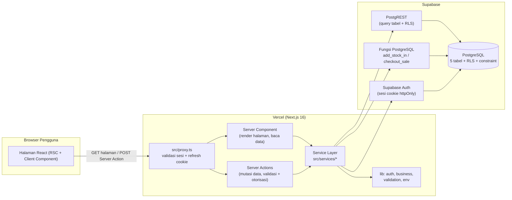
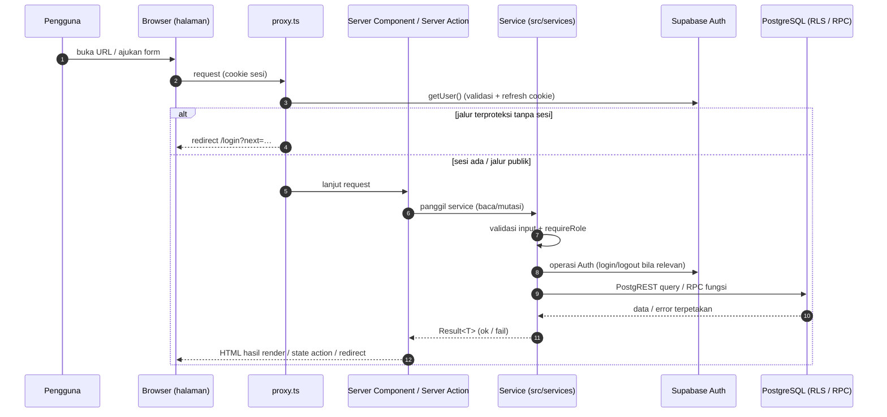

# Arsitektur Sistem STOKITA

Dokumen ini menjelaskan arsitektur aktual STOKITA berdasarkan kode sumber:
susunan frontend/backend, aliran komunikasi, tanggung jawab tiap lapis, serta
alur login, pengelolaan produk, dan penjualan.

## 1. Gambaran Umum

STOKITA adalah aplikasi **Next.js App Router** (single codebase) yang
berjalan di **Vercel** dan memakai **Supabase** sebagai layanan autentikasi
dan database PostgreSQL. Tidak ada backend terpisah: Server Component dan
Server Action Next.js **adalah** lapisan backend, yang berbicara ke
PostgreSQL melalui PostgREST (query biasa) dan RPC (fungsi transaksional).



## 2. Struktur Frontend dan Backend

| Lapis | Lokasi | Tanggung jawab |
| --- | --- | --- |
| Request boundary | `src/proxy.ts` | Cek keberadaan sesi untuk `/admin` & `/kasir`, refresh cookie, redirect `/login?next=…`. Konvensi Next.js 16 (pengganti `middleware.ts`). |
| Server Component (halaman) | `src/app/**/page.tsx`, `layout.tsx` | Render UI + mengambil data via service (`force-dynamic` — tanpa cache statis untuk halaman data). Layout role memegang otorisasi halaman. |
| Client Component | `src/components/*`, `*/components/*` | Interaksi (form, keranjang POS, dialog konfirmasi, pencarian, toggle status barang). State lokal + `useActionState` untuk hasil Server Action. |
| Server Action | `src/app/actions/auth.actions.ts`, `src/app/admin/**/actions.ts`, `src/app/kasir/penjualan/actions.ts` | Entrypoint mutasi dari klien; membaca FormData, memanggil service, mengembalikan state atau redirect. |
| Service layer | `src/services/*.ts` (`server-only`) | Validasi input, otorisasi (`requireRole`/`requireUser`), query/RPC Supabase, pemetaan error ke katalog pesan. |
| Lib | `src/lib/auth`, `lib/business`, `lib/validation`, `lib/env.ts` | Helper murni: otorisasi, logika bisnis (stok, pembayaran, zona waktu, format), validasi, validasi env. |
| Types | `src/types/*` | Kontrak tipe (`Result<T>`, `ServiceError`, tipe domain). |
| Database | `supabase/migrations/*`, `supabase/seed/*` | Skema, constraint, RLS, fungsi transaksional, data contoh. |

**Frontend vs backend dalam arti fisik:** UI dan logika server berada dalam
satu project Next.js; deploy satu unit ke Vercel. Tidak ada API route
HTTP/JSON terpisah — komunikasi klien→server memakai protokol Server Action
Next.js (POST dengan header `Next-Action`), dan server→database memakai
HTTP PostgREST/Supabase RPC.

## 3. Aliran Komunikasi



**Membaca data:** terjadi di dalam render Server Component (mis.
`listProducts`, `getDashboardSummary`) — bukan lewat `useEffect` fetch.

**Menulis data:** klien mengirim form ke Server Action → service memvalidasi
& mengautorisasi → PostgREST/RPC → state hasil (atau redirect `?ok=…`) →
client memuat ulang data lewat navigasi sehingga UI menyegarkan dari server.

## 4. Struktur Folder Penting

```
src/
  proxy.ts                 proteksi rute + refresh sesi
  app/
    page.tsx               root: redirect sesuai role
    layout.tsx             root layout (metadata, globals.css)
    actions/auth.actions.ts     login & logout
    login/                 halaman + form login (toggle ikon mata)
    admin/
      layout.tsx           requireRole("admin") + header/nav
      page.tsx             dashboard (ringkasan)
      nav.tsx              menu admin
      barang/              daftar barang + actions (CRUD/status/hapus)
      barang-masuk/        form barang masuk + riwayat IN + actions
      stok/                monitoring stok + riwayat mutasi
      penjualan/riwayat/   riwayat penjualan (admin) + detail [id]
    kasir/
      layout.tsx           requireRole("kasir")
      page.tsx             beranda kasir
      penjualan/           POS: page + actions (checkout) + komponen POS
        components/        sale-terminal, product-search, sale-cart,
                           payment-form, sale-receipt
        riwayat/           riwayat milik kasir + detail [id]
  components/              app-header, logout-button, confirm-dialog,
                           data-state (Empty/Error), access-denied, icons
  lib/
    supabase/server.ts     klien SSR (cookie) [client.ts: helper browser]
    auth/require-user.ts   getSessionProfile / requireUser
    auth/require-role.ts   requireRole(role)
    business/              stock-status, payment, quantity, date-range,
                           format, messages (katalog error)
    validation/product.ts  validasi form barang
    env.ts                 getSupabasePublicConfig (nama env wajib)
  services/                auth, product, stock, sales, dashboard, errors
  types/                   auth, product, sale, stock, history, result, …
supabase/migrations/       001 tabel, 002 constraint, 003 RLS/grant,
                           004 add_stock_in, 005 checkout_sale
supabase/seed/             seed_products.sql, seed_transactions.sql
scripts/create-accounts.mjs  pembuatan akun (admin API + profiles)
```

## 5. Alur Utama

### 5.1 Login

1. `GET /login` → `LoginForm` (bila sudah sesi, langsung redirect home role).
2. Submit → Server Action `login` → `authenticateUser`: validasi input →
   petakan username ke `{username}@stokita.local` → `signInWithPassword`.
3. Baca `profiles` → role & username valid? → gagal: `signOut` + pesan
   umum; sukses: `redirect(resolveHome(next, user))` (hanya prefix role).
4. Request berikutnya: `proxy.ts` memastikan sesi ada untuk area
   terproteksi.

Rincian sequence: [uml/sequence-login.md](uml/sequence-login.md).

### 5.2 Pengelolaan produk (admin)

- **Daftar/cari**: `/admin/barang` → `listProducts({ q })` (pencarian
  `ilike` kode/nama, semua status).
- **Tambah**: form → `createProductAction` → validasi
  `validateProductInput` → INSERT (stok awal saat insert — kolom `stok`
  tidak bisa di-UPDATE) → redirect `?ok=created`.
- **Edit**: `updateProductAction` → hanya atribut `kode, nama, harga_beli,
  harga_jual` (stok & stok_min tidak lewat form edit) → `?ok=updated`.
- **Aktif/nonaktif**: `setProductStatusAction(productId, aktif)` → UPDATE
  `aktif` (admin-only via RLS) → state `done` → navigasi `?ok=activated|deactivated`.
- **Hapus**: `deleteProductAction` → DELETE; bila punya riwayat, FK
  `sale_items.product_id` / `stock_movements.product_id` menolak (`23503`)
  dan UI menampilkan pesan + saran menonaktifkan.

### 5.3 Transaksi penjualan (kasir)

1. `/kasir/penjualan` memuat daftar `aktifOnly` → `SaleTerminal`.
2. Klien menyusun keranjang (qty, cek terhadap stok yang tampil) → dialog
   konfirmasi (ringkasan item/total/metode/bayar/kembalian) → submit form
   `checkoutAction`.
3. Service: validasi items/metode/qty → `requireRole("kasir")` → RPC
   `checkout_sale`: kunci baris `FOR UPDATE`, cek aktif & stok, hitung total
   di DB, validasi pembayaran, tulis `sales` + `sale_items` + kurangi stok +
   `stock_movements` OUT secara atomik.
4. Hasil berupa data struk → `SaleReceipt` ditampilkan; "Transaksi baru"
   mereset sesi POS.

Rincian: [uml/sequence-penjualan.md](uml/sequence-penjualan.md) dan
[uml/activity-penjualan.md](uml/activity-penjualan.md).

## 6. Penanganan Kesalahan dan Batas Tanggung Jawab

| Komponen | Bertanggung jawab atas | TIDAK bertanggung jawab atas |
| --- | --- | --- |
| `proxy.ts` | keberadaan sesi, refresh cookie, redirect login | penetapan role (layout/service/RLS yang memutuskan) |
| Layout role | akses halaman per role (redirect / AccessDenied) | validasi input, mutasi data |
| Server Action | membaca FormData, memanggil 1 service, menerjemahkan hasil ke state/redirect | logika bisnis (ada di service/RPC) |
| Service | validasi input, otorisasi ulang, query/RPC, `Result<T>` + pesan terpetakan | rendering UI, penyimpanan state klien |
| Fungsi DB (RPC) | atomik, lock, hitung ulang nilai uang/stok, cek role akhir | sesi login (menggunakan `auth.uid()` hasil login) |
| Client component | interaksi, perhitungan tampilan (util `payment.ts`), status pending | kebenaran data (semua diverifikasi ulang di server) |

**Alur error umum:** exception/failure → `mapSupabaseError` (katalog
`MESSAGES`) → `{ error }` di state form → dirender sebagai pesan
`role="alert"`; log diagnostik hanya di server (`reportServiceError`).
Redirect `?ok=…` hanya dikirim **setelah** operasi server sukses.

## 7. Catatan Desain

- Semua halaman data memakai `export const dynamic = "force-dynamic"` —
  konsisten dengan data transaksional yang selalu berubah.
- Konfirmasi aksi destruktif/penting (hapus barang, nonaktifkan, checkout,
  logout, simpan form) memakai `ConfirmDialog` bersama.
- Zona waktu bisnis `Asia/Jakarta` dipusatkan di
  `src/lib/business/date-range.ts`.
- Katalog pesan (`messages.ts`) adalah sumber kebenaran teks error
  aplikasi; kode SQLSTATE kustom disinkronkan dengan migrasi 004/005.

## 8. Temuan dan Keterbatasan

1. **Salah-pemetaan id Server Action (temuan, sudah diperbaiki).**
   Dua action berdampingan dalam satu modul
   (`activateProductAction`/`deactivateProductAction` lama) pernah terpetakan
   terbalik pada build produksi (Turbopack/Next.js 16.4): tombol
   "Nonaktifkan" memanggil aksi "aktif" dan sebaliknya — terdeteksi lewat
   pengujian browser sungguhan (respons flight `{"done": …}` berlawanan
   dengan tombol yang diklik). Solusi: diganti **satu**
   `setProductStatusAction(productId, aktif, …)`. Kode terkait:
   `src/app/admin/barang/actions.ts`.
2. **Submit form tanpa JavaScript (perlu investigasi).** Pada pengujian
   harness, POST Server Action mode MPA (tanpa JS) untuk re-render
   `/admin/barang` diamati menggantung pada stream respons; jalur browser
   dengan JS (yang dipakai pengguna) berfungsi normal. Belum dipastikan
   akar masalahnya (perilaku Next.js 16.4 vs lingkungan uji).
3. **`src/lib/supabase/client.ts` (helper klien browser) tidak dipakai**
   komponen mana pun — semua data via Server Component/Action. Kandidat
   pembersihan, bukan kebutuhan fungsional.
4. **Tanpa test suite otomatis**; verifikasi berjalan lewat lint, typecheck,
   build, dan pengujian manual/terotomasi sementara (tidak disimpan di repo).
5. **Riwayat dibatasi 100 baris terbaru** tanpa paginasi.
6. **Tidak ada CI/CD, monitoring, atau backup otomatis** yang terkonfigurasi
   di repository ini — lihat
   [Deployment dan Operasional](DEPLOYMENT_AND_OPERATIONS.md).

Dokumen terkait: [API dan Keamanan](API_AND_SECURITY.md),
[Database dan State](DATABASE_AND_STATE.md),
[UML Arsitektur](uml/arsitektur-sistem.md).
