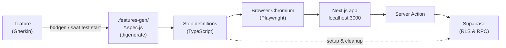

# 📚 Rangkuman Lengkap: BDD Automation Testing dengan Playwright — STOKITA

> **Dokumen ini untuk apa?** Panduan belajar dan bahan presentasi — memuat seluruh
> pengetahuan tentang implementasi BDD/integration testing di Stokita: konsep,
> arsitektur, kode, hasil, cara menjalankan, demo, hingga kisi-kisi tanya jawab.
>
> **Baca urut** untuk belajar (§1 → §7), atau langsung ke **§9 (demo)** dan
> **§10 (tanya jawab)** saat hari-H presentasi.

**Ringkasan satu kalimat:**
Stokita diuji otomatis dengan **Playwright + Playwright-BDD (bahasa Gherkin)**
sebanyak **5 fitur / 19 skenario end-to-end — semuanya lolos (19/19) dalam ±2,4
menit**, melalui UI → Server Action → Supabase, lengkap dengan lampiran dokumen,
11 screenshot, dan video rekaman.

---

## 1. Konsep Dasar (fundamental yang wajib paham)

### 1.1 Apa itu BDD?

**Behavior-Driven Development (BDD)** adalah pendekatan pengujian di mana skenario
ditulis dalam **bahasa manusia yang natural** (Gherkin) lebih dulu, lalu diubah
menjadi kode test otomatis. Tujuannya: **memaksaRequirement diungkap sebagai
perilaku yang bisa diuji**, dan bahasa yang sama dipakai oleh developer, QA, dan
pemilik bisnis.

Tiga kata kunci Gherkin:

| Kata | Arti | Di test |
| --- | --- | --- |
| **Given** | *Kondisi awal / pemasangan data* | Menyiapkan keadaan sebelum aksi |
| **When** | *Aksi / interaksi pengguna* | Klik, isi form, navigasi (lewat UI) |
| **Then** | *Hasil yang diharapkan (assertion)* | Memeriksa apakah benar terjadi |

Ditambah: **And** (lanjutan Given/When/Then), **Feature** (judul fitur), dan
**Scenario** (satu kasus uji konkret).

### 1.2 BDD vs Unit Testing vs Integration Testing

| Aspek | Unit Test (Vitest) | Integration/E2E (Playwright BDD) |
| --- | --- | --- |
| Cakupan | 1 fungsi/logika murni | Alur lengkap lintas komponen |
| Contoh | `calculateSubtotal()` | Login → cari barang → bayar → struk |
| Kecepatan | milidetik (66 test, 0,5 dtk) | menit (19 test, 2,4 mnt) |
| Media | kode saja | **browser sungguhan + database nyata** |
| Menemukan bug | Salah hitung, validasi | Integrasi putus, RLS salah, UI rusak |
| Ditulis dalam | TypeScript | **Gherkin (bahasa manusia)** |

Keduanya **saling melengkapi** — Stokita punya keduanya: `npm test` (Vitest, 66
kasus) dan `npm run test:bdd` (Playwright, 19 skenario).

### 1.3 Kenapa Playwright?

- **Browser engine sungguhan** (Chromium) → menguji aplikasi persis seperti
  dilihat pengguna.
- Fitur bawaan yang dibutuhkan untuk bukti presentasi: **video rekaman, screenshot
  saat gagal, trace (replay langkah), laporan HTML interaktif**.
- **`webServer` otomatis** → menjalankan `npm run dev` sendiri, tak perlu buka
  terminal kedua.
- Antarmuka locator berbasis **role/teks** (`getByRole`, `getByLabel`) → kode test
  terbaca seperti kalimat.

### 1.4 Kenapa `playwright-bdd`?

Playwright murni memakai kode TypeScript (`test('...', async ({page}) => ...)`).
**`playwright-bdd`** menambahkan lapisan Gherkin: membaca file `.feature`, lalu
**meng-generate** file test Playwright (di folder `.features-gen/`) yang
menghubungkan tiap kalimat Given/When/Then ke step definition. Hasilnya: Gherkin
yang rapi *dan* kekuatan Playwright.

> Versi yang dipakai: **Playwright 1.64** + **playwright-bdd 9.2** (lihat
> `package.json`).

---

## 2. Arsitektur & Alur Kerja Test



**Alur satu skenario (contoh: penjualan tunai):**

1. **Given** — `ada barang berkode "E2E-TUNAI"...` → step memanggil Supabase
   (service-role) untuk **menyiapkan data uji** *(hanya setup; bukan bagian yang
   diuji)*.
2. **When** — step membuka `/kasir/penjualan`, mengetik pencarian, klik **Tambah**,
   memilih metode, mengisi bayar, klik **Bayar & selesaikan** → **semuanya lewat
   UI seperti pengguna asli**, sehingga melewati Server Action + validasi + fungsi
   PostgreSQL `checkout_sale`.
3. **Then** — step memeriksa teks struk: total `Rp68.000`, kembalian `Rp32.000`,
   nomor `TRX-...`.
4. **After (hook)** — membersihkan data uji dari database.

> Prinsip penting: **setup/teardown boleh lewat API, tapi perilaku yang diuji
> selalu lewat UI.** Jadi test tetap menguji jalur produksi sebenarnya.

---

## 3. Peta Struktur Folder

```
playwright.config.ts                 Konfigurasi: BDD + Playwright + webServer
tests/e2e/
├── features/                        ⭐ SUMBER KEBENARAN skenario (Gherkin)
│   ├── 01-autentikasi.feature       4 skenario: login admin/kasir, password salah, logout
│   ├── 02-barang.feature            5 skenario: tambah, duplikat, ubah, nonaktif, hapus
│   ├── 03-barang-masuk.feature      3 skenario: stok bertambah, riwayat, monitoring
│   ├── 04-penjualan.feature         4 skenario: tunai, non-tunai, bayar kurang, riwayat
│   └── 05-otorisasi.feature         3 skenario: larangan silang role, tamu → login
├── steps/                           Definisi step (kode TypeScript)
│   ├── auth.steps.ts                navigasi, login, logout, asersi teks
│   ├── product.steps.ts             CRUD barang + dialog konfirmasi
│   ├── stock-in.steps.ts            barang masuk, riwayat, monitoring stok
│   ├── sale.steps.ts                POS: keranjang, bayar, struk, riwayat
│   └── hooks.ts                     BeforeAll (pemanasan) + After (pembersihan)
├── fixtures.ts                      `test` kustom + fixture `skenario` + createBdd()
└── support/
    ├── env.ts                       baca .env.local; akun uji (rahasia di env)
    ├── api.ts                       klien service-role: siapkan & bersihkan data uji
    └── ui.ts                        helper login, locator, normRupiah
scripts/
├── capture-evidence.mjs             generate 11 screenshot lampiran
└── merge-test-videos.mjs            gabung 19 video → 1 video utuh
docs/
├── BDD_TESTING.md                   Dokumen resmi implementasi (lampiran 📄)
├── images/                          11 screenshot (lampiran 🖼️)
└── lampiran/video-bdd-stokita.webm  Video gabungan (lampiran 🎥)
```

Folder **`.features-gen/`, `test-results/`, `playwright-report/`** adalah hasil
generate/artefak → **tidak di-commit** (sudah masuk `.gitignore`).

---

## 4. Anatomi Kode (yang paling mungkin ditanyakan)

### 4.1 File `.feature` — bahasa Gherkin

```gherkin
Feature: Penjualan kasir (POS)
  Sebagai kasir, saya ingin mencari barang, menyusun keranjang, memilih metode
  pembayaran, dan menyelesaikan transaksi yang menghasilkan struk.

  Scenario: Penjualan tunai menghitung kembalian dan menerbitkan struk
    Given saya login sebagai kasir
    And ada barang berkode "E2E-TUNAI" bernama "Barang Uji Tunai" dengan harga jual 68000 stok 20 stok minimum 5
    When saya membuka halaman penjualan
    And saya cari barang "E2E-TUNAI" lalu tambahkan ke keranjang
    Then total keranjang menampilkan "Rp68.000"
    When saya pilih metode pembayaran "TUNAI"
    And saya isi uang dibayar 100000
    Then saya melihat perkiraan kembalian "Rp32.000"
    When saya selesaikan pembayaran
    Then struk transaksi ditampilkan dengan total "Rp68.000" dan kembalian "Rp32.000"
```

**Yang harus dijelaskan ke dosen:**
- Baris `"E2E-TUNAI"` / angka `68000` adalah **parameter** — satu step bisa
  dipakai ulang untuk data berbeda (`.feature` lain memakai kode barang lain).
- Alur *komentar bisnis* (`Sebagai ... saya ingin ...`) = konteks kebutuhan.
- Satu `Feature` = satu fitur bisnis; satu `Scenario` = satu kasus uji.

### 4.2 Step definition — jembatan Gherkin → kode

```ts
// tests/e2e/steps/sale.steps.ts
When("saya cari barang {string} lalu tambahkan ke keranjang",
  async ({ page }, kode: string) => {
    await page.locator("#cari-barang").fill(kode);
    const item = page.locator(".pos-item").filter({ hasText: kode }).first();
    await item.getByRole("button", { name: "Tambah" }).click();
  });

Then("struk transaksi ditampilkan dengan total {string} dan kembalian {string}",
  async ({ page, skenario }, total: string, kembalian: string) => {
    const struk = page.getByTestId("struk");
    await expect(struk).toBeVisible();
    // ... normalisasi + cek teks total & kembalian ...
    skenario.noTransaksi = (await struk.locator(".receipt-no").textContent())?.trim();
  });
```

- `{string}` dan `{int}` = **placeholder** yang cocok dengan parameter di `.feature`.
- `page` = halaman browser (fixture Playwright).
- `expect(...)` = **assertion** (bagian Then).

### 4.3 Fixture `skenario` — berbagi data antar step

```ts
// tests/e2e/fixtures.ts
export const test = base.extend<{ skenario: SkenarioData }>({
  skenario: async ({}, use) => { await use({}); },   // umur: 1 skenario
});
export const { Given, When, Then, After, BeforeAll } = createBdd(test);
```

**Contoh pemakaian nyata:** struk menyimpan `noTransaksi` (mis. `TRX-20261103...`),
kemudian step riwayat memakai nomor itu untuk mencari baris transaksinya.
Tanpa fixture, step-step tersebut tidak bisa saling kenal.

### 4.4 Hooks — `BeforeAll` dan `After`

| Hook | Fungsi | Di kode |
| --- | --- | --- |
| `BeforeAll` | **Pemanasan**: membuka seluruh rute utama sekali agar Next.js dev mengompilasinya → skenario pertama tidak lambat | `hooks.ts` |
| `After` | **Pembersihan**: hapus penjualan uji → mutasi stok → produk (fallback: nonaktifkan bila terikat riwayat). Kegagalan bersih-bersih hanya dilogkan, tidak menggagalkan test | `hooks.ts` |

### 4.5 Konfigurasi penting (`playwright.config.ts`)

| Opsi | Nilai | Alasan |
| --- | --- | --- |
| `workers` / `fullyParallel` | `1` / `false` | deterministik, video berurutan |
| `video` | `"on"` | rekaman tiap skenario → lampiran video 🎥 |
| `screenshot` | `"only-on-failure"` | bukti visual saat gagal |
| `trace` | `"retain-on-failure"` | bisa "replay" langkah saat gagal |
| `locale` / `timezoneId` | `id-ID` / `Asia/Jakarta` | format rupiah & tanggal sesuai aplikasi |
| `webServer` | `npm run dev` | server start otomatis, dipakai ulang bila sudah jalan |
| `defineBddConfig` | features + steps | lokasi `.feature` & step (termasuk `fixtures.ts`) |

---

## 5. Keputusan Desain Test (nilai plus saat presentasi)

1. **Selector stabil** — memakai peran & teks (`getByRole("button", { name: "Hapus" })`,
   `#username`, `data-testid="struk"`), bukan class CSS acak → test tidak mudah
   rusak saat styling berubah, dan terbaca manusia.
2. **Data uji berawalan `E2E-`** (`E2E-TUNAI`, `E2E-HAPUS`, ...) → mudah
   dikenali & dibersihkan; tidak mencemari data produksi.
3. **Setup via API (service-role), aksi/assertion via UI** → efisien tetapi
   tetap menguji jalur nyata.
4. **Password tidak pernah ditulis di file `.feature`** — hanya dibaca dari
   env (`STOKITA_ADMIN_PASSWORD`, dst.) → dokumen aman dibagikan.
5. **Pembersihan otomatis + idempoten** → suite bisa dijalankan berulang.
   *Bukti:* setelah run terakhir, `produk E2E tersisa: []`, `mutasi uji: 0`,
   `sales 1 jam terakhir: 0`.
6. **Normalisasi rupiah (`normRupiah`)** — `Intl` `id-ID` menghasilkan spasi
   tak terlihat (NBSP): `"Rp 68.000"`; semua perbandingan teks dinormalkan
   dulu agar tidak gagal palsu.
7. **Menangani kegagalan yang *diharapkan*** — mis. skenario "kode duplikat
   ditolak": step menunggu *salah satu dari* redirect **atau** muncul pesan
   error (Promise.race), karena dua-duanya hasil valid.
8. **Satu kali pemanasan rute (`BeforeAll`)** → total runtime turun ke ±2,4 menit.

---

## 6. Tabel 19 Skenario & Hasil

| # | Fitur | Skenario | Status |
| --- | --- | --- | --- |
| 1 | Autentikasi | Admin berhasil masuk dan tiba di dashboard admin | ✅ lolos |
| 2 | Autentikasi | Kasir berhasil masuk dan tiba di halaman kasir | ✅ lolos |
| 3 | Autentikasi | Password salah ditolak dengan pesan yang jelas | ✅ lolos |
| 4 | Autentikasi | Keluar dari aplikasi mengakhiri sesi | ✅ lolos |
| 5 | Barang | Menambah barang baru | ✅ lolos |
| 6 | Barang | Kode barang duplikat ditolak | ✅ lolos |
| 7 | Barang | Mengubah data barang | ✅ lolos |
| 8 | Barang | Menonaktifkan barang | ✅ lolos |
| 9 | Barang | Menghapus barang yang belum memiliki riwayat | ✅ lolos |
| 10 | Barang masuk | Barang masuk menambah stok barang | ✅ lolos |
| 11 | Barang masuk | Barang masuk tercatat di riwayat | ✅ lolos |
| 12 | Barang masuk | Barang yang stoknya kembali aman hilang dari monitoring | ✅ lolos |
| 13 | Penjualan | Penjualan tunai menghitung kembalian dan menerbitkan struk | ✅ lolos |
| 14 | Penjualan | Penjualan non-tunai dua unit tanpa kembalian | ✅ lolos |
| 15 | Penjualan | Pembayaran kurang dari total ditolak | ✅ lolos |
| 16 | Penjualan | Penjualan muncul di riwayat kasir | ✅ lolos |
| 17 | Otorisasi | Kasir tidak dapat membuka halaman admin | ✅ lolos |
| 18 | Otorisasi | Admin tidak dapat membuka halaman kasir | ✅ lolos |
| 19 | Otorisasi | Pengunjung tanpa sesi dialihkan ke halaman login | ✅ lolos |

**Total: 19/19 lolos (100%) dalam ±2,4 menit** — plus 66/66 unit test, typecheck,
lint, dan build produksi semuanya hijau.

---

## 7. Cara Menjalankan (wajib hafal untuk demo)

```bash
# Prasyarat (sekali saja)
npm install
npx playwright install chromium
cp .env.example .env.local     # isi Supabase + password akun uji

# Perintah harian
npm run test:bdd               # jalankan 19 skenario (server start otomatis)
npm run test:bdd:headed        # menonton browser berjalan
npm run test:bdd:report        # laporan HTML interaktif
npx playwright test 02-barang  # jalankan satu fitur saja
npx bddgen                     # hanya generate test dari .feature (tanpa run)
```

**Troubleshooting cepat:**

| Gejala | Penyebab / solusi |
| --- | --- |
| `ERR_CONNECTION_REFUSED` | `next dev` berhenti karena nudge upgrade → jalankan ulang `npm run dev` |
| Env tidak ditemukan | `.env.local` belum ada/lengkap |
| Browser tidak ditemukan | `npx playwright install chromium` |
| Login gagal di test | Samakan `STOKITA_*_PASSWORD` dengan akun hasil `npm run seed:accounts` |

---

## 8. Artefak & Lampiran

| Lampiran | Nilai | Perintah |
| --- | --- | --- |
| 📄 Dokumen | `docs/BDD_TESTING.md` (dokumen resmi) | diedit manual |
| 🖼️ Gambar | `docs/images/` — **11 screenshot** | `node scripts/capture-evidence.mjs` |
| 🎥 Video | `docs/lampiran/video-bdd-stokita.webm` — **5,9 MB, ±2:43**, gabungan 19 klip | `npm run test:bdd` lalu `node scripts/merge-test-videos.mjs` |
| 📊 Laporan | `playwright-report/` — klik per skenario untuk lihat step/screenshot/video/trace | `npm run test:bdd:report` |
| 📁 Repo | **PR #2**: https://github.com/JihanGaluhPutri/STOKITA/pull/2 · commit `114ae85` | — |

**Cara pakai laporan HTML saat presentasi:** buka `npm run test:bdd:report` →
klik skenario *Penjualan tunai* → tunjukkan daftar langkah Gherkin yang terekam
per langkah + video + screenshot.

---

## 9. 🎬 Script Demo Presentasi (±5 menit)

1. **(30 dtk) Buka kode `.feature`** — tunjukkan `tests/e2e/features/04-penjualan.feature`,
   bacakan satu skenario keras-keras: *"Ini bahasa manusia, ini requirement-nya."*
2. **(30 dtk) Tunjukkan step definition** — buka `sale.steps.ts`, tunjukkan
   baris `{string}` cocok dengan parameter, dan `page.locator("#cari-barang")`.
3. **(1 mnt) Jalankan demo live** di terminal:
   ```bash
   npx playwright test 04-penjualan --headed
   ```
   Browser terbuka dan mengeksekusi 4 skenario penjualan. *(Tips: jalankan
   beberapa menit sebelum giliran bicara agar server ter-warm-up; siapkan juga
   `npm run test:bdd:report` sebagai cadangan bila koneksi lambat.)*
4. **(1 mnt) Buka laporan HTML** — tunjukkan 19 skenario hijau + klik salah satu
   untuk menunjukkan bukti per langkah.
5. **(1 mnt) Tunjukkan lampiran** — screenshot struk (`docs/images/10-struk-transaksi.png`)
   dan video `docs/lampiran/video-bdd-stokita.webm`.
6. **(1 mnt) tutup dengan angka**: 19/19 skenario, 66/66 unit test, DB bersih
   otomatis, dan link GitHub (PR #2).

---

## 10. 🎯 Kisi-Kisi Tanya Jawab (prediksi pertanyaan dosen)

**Q: Apa bedanya BDD dengan unit testing yang sudah ada?**
A: Unit (Vitest, 66 kasus) menguji fungsi murni seperti `calculateSubtotal` —
cepat tetapi tidak melihat UI/integrasi. BDD (19 skenario) menguji **alur utuh**
lewat browser → Server Action → Supabase, termasuk hal yang tak terlihat oleh
unit test: RLS, redirect, validasi form, dan SQL fungsi `checkout_sale`.

**Q: Kenapa memakai Playwright, bukan Cypress/Selenium?**
A: Playwright modern, multi-browser, fitur bukti bawaan (video/screenshot/trace/
laporan) sangat lengkap, dan `webServer`-nya bisa menyalakan dev server sendiri.
`playwright-bdd` memberi sintaks Gherkin tanpa kehilangan fitur Playwright.

**Q: Apakah test-nya merusak data produksi?**
A: Tidak. Data uji diberi awalan `E2E-`, disiapkan lewat service-role dan
**dibersihkan otomatis** oleh hook `After` setelah tiap skenario — terbukti dari
cek database setelah run: sisa produk/mutasi/penjualan uji = 0.

**Q: Kenapa `workers: 1` — apakah lama?**
A: Demi determinisme dan video yang berurutan; total ±2,4 menit masih wajar.
Bisa dinaikkan bila tiap worker diberi data terpisah.

**Q: Bagaimana bila selector aplikasi berubah?**
A: Test memakai peran/teks (`getByRole`) dan `data-testid`, bukan class CSS —
perubahan styling tidak mempengaruhi. Bila label teks berubah, cukup perbaiki
satu baris di step definition.

**Q: Apa kelemahannya / rencana pengembangan?**
A: (1) belum ada CI — rencananya GitHub Actions menjalankan
`lint + typecheck + test + test:bdd`; (2) masih memakai database yang sama
(dibersihkan) — idealnya pakai proyek Supabase terpisah; (3) belum mencakup
filter tanggal riwayat, reset password, dan batas 100 baris.

**Q: Di mana kode & buktinya?**
A: **PR #2** https://github.com/JihanGaluhPutri/STOKITA/pull/2 (36 file),
commit `114ae85`, 5 file `.feature`, dokumentasi `docs/BDD_TESTING.md`, 11
screenshot `docs/images/`, video `docs/lampiran/video-bdd-stokita.webm`.

**Q: Apa peran Gherkin dalam tim nyata?**
A: Jadi **kontrak bahasa bersama**: analis menulis kebutuhan sebagai skenario,
developer mengimplementasikan step-nya, dan skenario itu hidup sebagai test
otomatis — requirement tidak kehilangan jejak jadi kode.

---

## 11. Glosarium Istilah

| Istilah | Penjelasan singkat |
| --- | --- |
| **BDD** | Behavior-Driven Development — test ditulis sebagai perilaku dalam bahasa natural |
| **Gherkin** | Bahasa format `.feature` (Feature/Scenario/Given/When/Then) |
| **Feature** | Satu fitur bisnis, berisi beberapa skenario |
| **Scenario** | Satu kasus uji konkret dengan langkah Given-When-Then |
| **Step definition** | Kode TS yang menerjemahkan satu kalimat Gherkin jadi aksi Playwright |
| **Fixture** | Data/objek yang disediakan framework per test (di sini: `skenario`) |
| **Hook** | Kode yang jalan otomatis sebelum/sesudah skenario (`BeforeAll`, `After`) |
| **bddgen** | Perintah meng-generate file test Playwright dari `.feature` |
| **workers** | Jumlah browser paralel yang menjalankan test (di sini 1) |
| **Trace** | Rekaman detail langkah Playwright, bisa dibuka saat gagal |
| **Service-role key** | Kunci Supabase hak penuh — di test hanya untuk setup/cleanup data |
| **Idempoten** | Bisa dijalankan berulang tanpa menumpuk data (menyiapkan = INSERT bila belum ada) |
| **NBSP** | Spasi tak terlihat `Rp 68.000` hasil `Intl id-ID` — dinormalkan oleh `normRupiah` |

---

### 📎 Dokumen terkait

- [BDD_TESTING.md](BDD_TESTING.md) — dokumentasi resmi implementasi (lampiran 📄)
- [UNIT_TESTING.md](UNIT_TESTING.md) — unit testing Vitest (66 kasus)
- [USE_CASE_AND_FLOW.md](USE_CASE_AND_FLOW.md) — use case & alur bisnis
- [USER_GUIDE.md](USER_GUIDE.md) — panduan pengguna aplikasi
- [ARCHITECTURE.md](ARCHITECTURE.md) — arsitektur sistem
