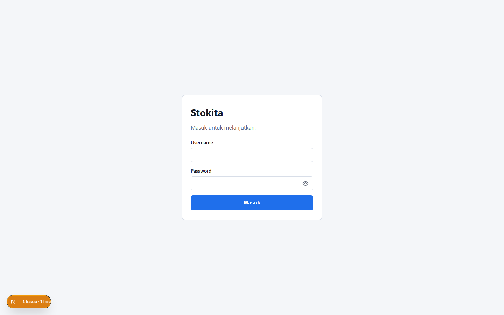
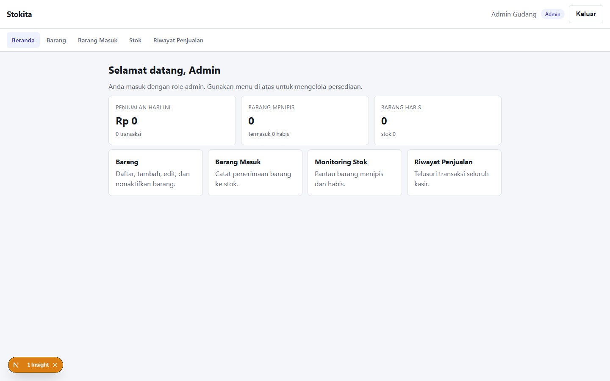
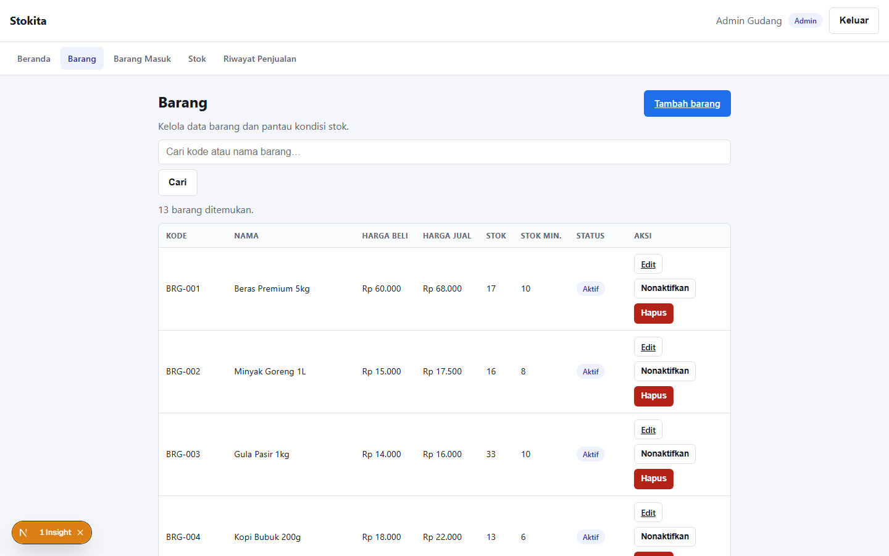
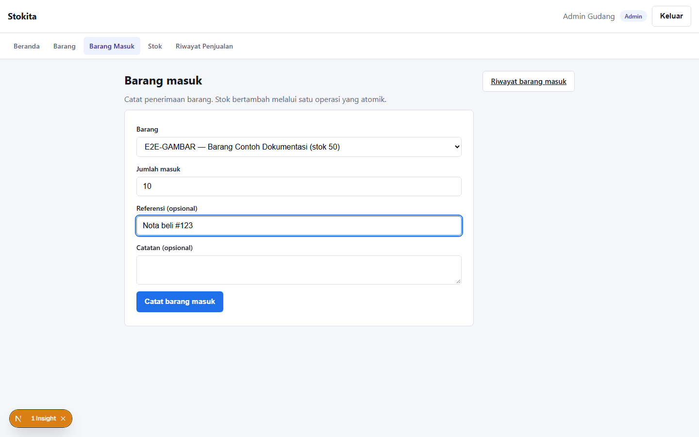
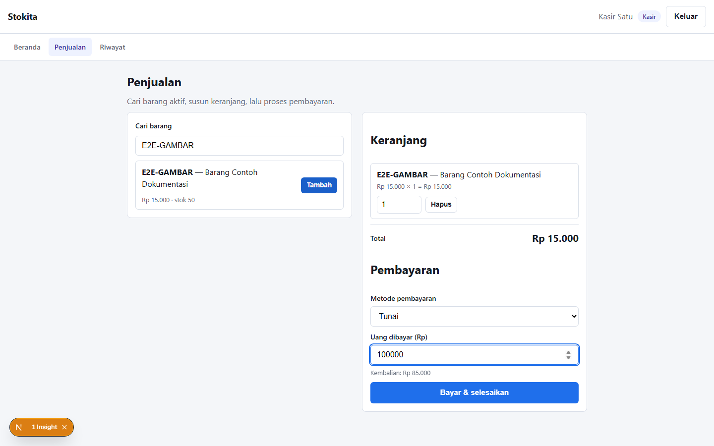
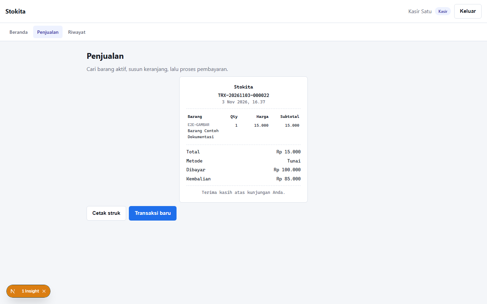

# Dokumen BDD & Integration Testing — STOKITA

**Framework:** Playwright `1.64` + Playwright-BDD `9.2` (Gherkin/Cucumber)
**Konfigurasi:** `playwright.config.ts` · **Jalur:** `npm run test:bdd`
**Cakupan:** uji end-to-end/integrasi melewati UI → Server Action → Supabase (RLS & RPC)
**Hasil terakhir:** **5 fitur · 19 skenario · seluruhnya lolos (19/19) · ±2,4 menit**

---

## 1. Ringkasan Implementasi

BDD automation testing diterapkan pada **alur bisnis utama Stokita** — login,
kelola barang, barang masuk, penjualan POS, dan otorisasi role — sehingga setiap
perubahan kode dapat diverifikasi ulang dengan satu perintah.

| # | Fitur (`.feature`) | Skenario | Yang diverifikasi |
| --- | --- | --- | --- |
| 1 | `01-autentikasi.feature` | 4 | Login admin/kasir, penolakan password salah, logout |
| 2 | `02-barang.feature` | 5 | Tambah, kode duplikat, ubah, nonaktifkan, hapus barang |
| 3 | `03-barang-masuk.feature` | 3 | Stok bertambah, riwayat barang masuk, monitoring stok |
| 4 | `04-penjualan.feature` | 4 | Tunai + kembalian, non-tunai, bayar kurang, riwayat kasir |
| 5 | `05-otorisasi.feature` | 3 | Kasir↔admin ditolak, tamu dialihkan ke login |
| | **Total** | **19** | |

### Struktur berkas

```
playwright.config.ts              konfigurasi Playwright + defineBddConfig()
tests/e2e/
├── features/                     5 file Gherkin (sumber skenario)
│   ├── 01-autentikasi.feature
│   ├── 02-barang.feature
│   ├── 03-barang-masuk.feature
│   ├── 04-penjualan.feature
│   └── 05-otorisasi.feature
├── steps/                        definisi step (TypeScript)
│   ├── auth.steps.ts             navigasi, login, keluar, asersi teks
│   ├── product.steps.ts          CRUD barang lewat UI + dialog konfirmasi
│   ├── stock-in.steps.ts         barang masuk, riwayat, monitoring
│   ├── sale.steps.ts             POS: keranjang, bayar, struk, riwayat
│   └── hooks.ts                  pemanasan rute + pembersihan data (After)
├── fixtures.ts                   test kustom + fixture `skenario` + createBdd()
└── support/
    ├── env.ts                    baca .env.local & akun uji (rahasia di env)
    ├── api.ts                    klien service-role: siapkan & bersihkan data uji
    └── ui.ts                     helper login, locator, format rupiah
scripts/
├── capture-evidence.mjs          generate screenshot lampiran (docs/images/)
└── merge-test-videos.mjs         gabungkan video rekaman jadi satu berkas
```

> Berkas `.features-gen/` (test yang digenerate Playwright-BDD) dan
> `test-results/`, `playwright-report/` **tidak di-commit** — sudah masuk
> `.gitignore`.

---

## 2. Cara Menjalankan

### Prasyarat

```bash
npm install                       # dependensi (termasuk @playwright/test & playwright-bdd)
npx playwright install chromium   # browser uji (sekali saja)
cp .env.example .env.local        # lalu isi Supabase + akun uji
npm run seed:accounts             # membuat akun admin & kasir (sekali saja)
```

Variabel wajib di `.env.local`:

| Variabel | Kegunaan |
| --- | --- |
| `NEXT_PUBLIC_SUPABASE_URL`, `NEXT_PUBLIC_SUPABASE_ANON_KEY` | koneksi aplikasi |
| `SUPABASE_SERVICE_ROLE_KEY` | membersihkan data uji (hanya test) |
| `STOKITA_ADMIN_PASSWORD`, `STOKITA_KASIR1_PASSWORD` | login uji admin/kasir |

Password **tidak pernah** ditulis di file `.feature` maupun step — dokumen BDD
aman dibagikan.

### Perintah

```bash
npm run test:bdd           # seluruh 19 skenario (otomatis menjalankan `npm run dev`)
npm run test:bdd:headed    # menonton browser berjalan
npm run test:bdd:report    # membuka laporan HTML interaktif
npx playwright test 02-barang   # menjalankan satu fitur saja
npx bddgen                 # hanya meng-generate test dari .feature (tanpa menjalankan)
```

Playwright menyalakan sendiri dev server (`webServer` di konfigurasi) dan
memakai ulang server yang sudah berjalan, jadi tidak perlu membuka terminal
kedua.

### Masalah yang paling sering muncul

| Gejala | Penyebab & solusi |
| --- | --- |
| `ERR_CONNECTION_REFUSED` | `next dev` berhenti karena *upgrade reminder* keamanan Next.js. Jalankan ulang `npm run dev` (percobaan kedua langsung lanjut), lalu `npm run test:bdd` |
| `Variabel env "..." tidak ditemukan` | `.env.local` belum ada/lengkap — salin dari `.env.example` |
| Browser tidak ditemukan | `npx playwright install chromium` |
| Password salah di test | Samakan `STOKITA_*_PASSWORD` dengan akun hasil `npm run seed:accounts` |

---

## 3. Desain Test

### 3.1 Selektor yang stabil

Step memakai selektor berbasis **peran & teks** (`getByRole`, `getByLabel`,
`data-testid="struk"`, `#username`, `#kode`, `#metodeBayar`) — mengikuti
struktur UI aplikasi sehingga tetap terbaca manusia dan tahan perubahan CSS.

### 3.2 Fixture `skenario`

`fixtures.ts` menambahkan fixture berumur-skenario untuk berbagi data antar
step (kode barang, nama, nomor transaksi). Contoh: struk menangkap
`noTransaksi`, lalu step riwayat memakai nomor itu untuk mencari barisnya.

### 3.3 Data uji & kebersihan database

- Semua data buatan test memakai awalan **`E2E-`** (`E2E-TAMBAH`, `E2E-TUNAI`, …).
- Langkah `Given` menyiapkan data lewat service-role (**idempoten**);
  langkah `When`/`Then` selalu lewat **UI + Server Action** — perilaku yang
  diuji tetap jalur produksi.
- Hook `After` membersihkan tiap skenario: penjualan uji → mutasi stok →
  produk. Bila produk masih terikat riwayat yang tidak dapat dihapus, ia
  **dinonaktifkan** (meniru perilaku aplikasi yang menolak hapus ber-riwayat).
- Kegagalan pembersihan hanya dilogkan, tidak menggagalkan test.

Verifikasi setelah run terakhir: `produk E2E tersisa: 0`, `mutasi uji: 0`,
`penjualan 1 jam terakhir: 0` — database kembali bersih.

### 3.4 Konfigurasi penting (`playwright.config.ts`)

| Opsi | Nilai | Alasan |
| --- | --- | --- |
| `workers` / `fullyParallel` | `1` / `false` | deterministik & video berurutan |
| `video` | `"on"` | rekaman tiap skenario → lampiran video |
| `screenshot` | `"only-on-failure"` | bukti visual saat gagal |
| `trace` | `"retain-on-failure"` | replay langkah saat gagal |
| `locale` / `timezoneId` | `id-ID` / `Asia/Jakarta` | format rupiah & tanggal sesuai aplikasi |
| `webServer` | `npm run dev` | server otomatis, pakai ulang bila sudah jalan |
| `BeforeAll` | pemanasan rute | Next.js dev mengompilasi tiap rute sekali saat pertama dibuka |

---

## 4. Hasil Eksekusi Terakhir

```
Running 19 tests using 1 worker
  ok  1  01-autentikasi · Admin berhasil masuk dan tiba di dashboard admin   (5.6s)
  ok  2  01-autentikasi · Kasir berhasil masuk dan tiba di halaman kasir     (3.2s)
  ok  3  01-autentikasi · Password salah ditolak dengan pesan yang jelas     (1.8s)
  ok  4  01-autentikasi · Keluar dari aplikasi mengakhiri sesi               (4.0s)
  ok  5  02-barang · Menambah barang baru                                   (10.1s)
  ok  6  02-barang · Kode barang duplikat ditolak                            (7.5s)
  ok  7  02-barang · Mengubah data barang                                   (10.8s)
  ok  8  02-barang · Menonaktifkan barang                                   (8.9s)
  ok  9  02-barang · Menghapus barang yang belum memiliki riwayat            (7.1s)
  ok 10  03-barang-masuk · Barang masuk menambah stok barang                (10.6s)
  ok 11  03-barang-masuk · Barang masuk tercatat di riwayat                 (12.0s)
  ok 12  03-barang-masuk · Barang yang stoknya kembali aman hilang dari monitoring (11.3s)
  ok 13  04-penjualan · Penjualan tunai menghitung kembalian dan menerbitkan struk (8.7s)
  ok 14  04-penjualan · Penjualan non-tunai dua unit tanpa kembalian         (8.6s)
  ok 15  04-penjualan · Pembayaran kurang dari total ditolak                 (7.1s)
  ok 16  04-penjualan · Penjualan muncul di riwayat kasir                    (9.5s)
  ok 17  05-otorisasi · Kasir tidak dapat membuka halaman admin              (3.8s)
  ok 18  05-otorisasi · Admin tidak dapat membuka halaman kasir              (4.6s)
  ok 19  05-otorisasi · Pengunjung tanpa sesi dialihkan ke halaman login     (0.7s)

  19 passed (2.4m)
```

Serenitas/kebersihan data dipastikan setelah run (lihat §3.3).

---

## 5. Pelaporan & Lampiran

| Lampiran | Sumber | Perintah |
| --- | --- | --- |
| **Dokumen** | `docs/BDD_TESTING.md` ini | — |
| **Gambar** | `docs/images/*.png` (11 screenshot) | `node scripts/capture-evidence.mjs` |
| **Video** | `docs/lampiran/video-bdd-stokita.webm` (gabungan 19 skenario, ±2,4 menit) | `npm run test:bdd` lalu `node scripts/merge-test-videos.mjs` |
| **Laporan HTML** | `playwright-report/` (klik per skenario untuk melihat step/screenshot/video) | `npm run test:bdd:report` |

### Pratinjau screenshot

| | |
| --- | --- |
|  |  |
|  |  |
|  |  |

---

## 6. Batasan & Tindak Lanjut

1. **Belum ada CI** — suite berjalan lokal; langkah berikutnya menambahkan
   GitHub Actions (`npm run lint && npm run typecheck && npm test && npm run test:bdd`).
2. **Menyentuh database nyata** — test memakai data ber-awalan `E2E-` dan
   membersihkannya; untuk isolasi penuh dibutuhkan proyek Supabase terpisah
   (branch/`STAGING`) lewat variabel env.
3. **Satu worker** — demi determinisme; bisa dinaikkan bila data antar skenario
   dipisah per worker.
4. **Belum mencakup** reset password, filter tanggal riwayat, dan batas 100
   baris — kandidat skenario berikutnya.

Dokumen terkait: [BDD_RANGKUMAN.md](BDD_RANGKUMAN.md) (rangkuman belajar &
presentasi), [UNIT_TESTING.md](UNIT_TESTING.md),
[USE_CASE_AND_FLOW.md](USE_CASE_AND_FLOW.md),
[USER_GUIDE.md](USER_GUIDE.md),
[ARCHITECTURE.md](ARCHITECTURE.md).
