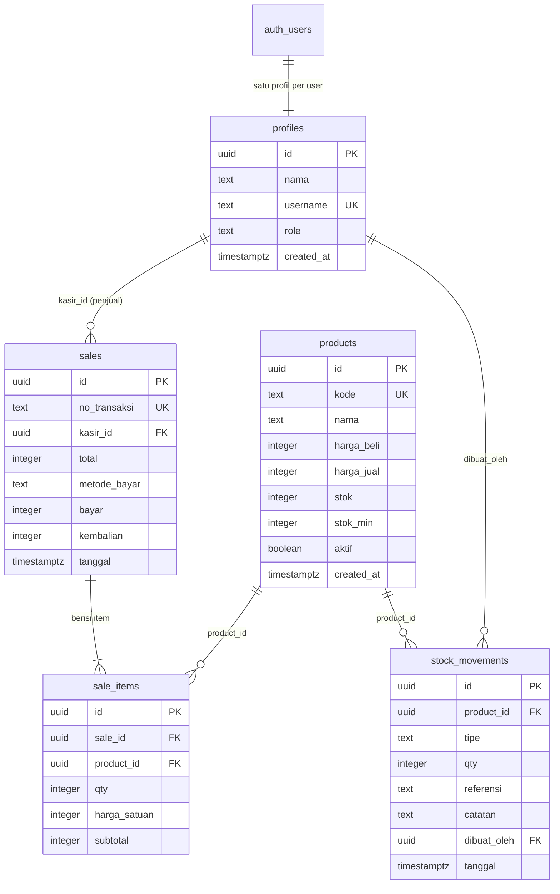
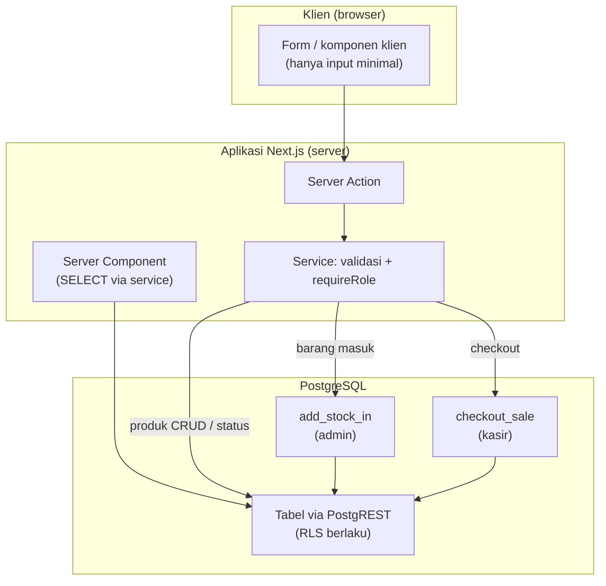

# Database dan State STOKITA

Dokumen ini mendeskripsi database aktual STOKITA (Supabase/PostgreSQL)
berdasarkan file migrasi di `supabase/migrations/` dan cara aplikasi
membaca/menuliskan state. **Sumber kebenaran: migrasi 001–005.**

## 1. Database yang Digunakan

- **PostgreSQL** yang dikelola **Supabase** (PostgREST untuk query tabel,
  `supabase.rpc(...)` untuk fungsi).
- Koneksi aplikasi memakai **anon/publishable key + sesi pengguna**
  (bukan service role) sehingga **RLS berlaku** pada setiap query.
- Identifier proyek/kredensial tidak dicantumkan di dokumen ini; nilainya
  ada di `.env.local` / environment Vercel (lihat
  [README](../README.md#variabel-lingkungan)).

## 2. Tabel Aktual

Dibuat oleh `supabase/migrations/001_create_core_tables.sql`, constraint
bisnis `002_constraints.sql`.

### 2.1 `profiles`

Profil pengguna — satu-satu dengan `auth.users`.

| Kolom | Tipe | Ket. |
| --- | --- | --- |
| `id` | uuid PK | FK → `auth.users(id)` `ON DELETE CASCADE` |
| `nama` | text NOT NULL | nama tampilan |
| `username` | text NOT NULL | UNIQUE (`profiles_username_unik`), dipakai login |
| `role` | text NOT NULL | CHECK `('admin','kasir')` (002) |
| `created_at` | timestamptz NOT NULL | default `now()` |

### 2.2 `products`

| Kolom | Tipe | Ket. |
| --- | --- | --- |
| `id` | uuid PK | default `gen_random_uuid()` |
| `kode` | text NOT NULL | UNIQUE (`products_kode_unik`) |
| `nama` | text NOT NULL | index `idx_products_nama` |
| `harga_beli` | integer NOT NULL | default 0, CHECK ≥ 0 |
| `harga_jual` | integer NOT NULL | CHECK ≥ 0 |
| `stok` | integer NOT NULL | default 0, CHECK ≥ 0 — **hanya bisa diubah fungsi RPC** |
| `stok_min` | integer NOT NULL | default 0, CHECK ≥ 0 |
| `aktif` | boolean NOT NULL | default true — status aktif/nonaktif |
| `created_at` | timestamptz NOT NULL | default `now()` |

### 2.3 `sales`

| Kolom | Tipe | Ket. |
| --- | --- | --- |
| `id` | uuid PK | default `gen_random_uuid()` |
| `no_transaksi` | text NOT NULL | UNIQUE; format `TRX-YYYYMMDD-NNNNNN` (dibangkitkan fungsi `checkout_sale` dari sequence `seq_no_transaksi`) |
| `kasir_id` | uuid NOT NULL | FK → `profiles(id)` `ON DELETE RESTRICT` |
| `total` | integer NOT NULL | CHECK ≥ 0 |
| `metode_bayar` | text NOT NULL | CHECK `('TUNAI','NON_TUNAI')` (002) |
| `bayar` | integer NOT NULL | CHECK ≥ 0 dan CHECK `bayar >= total` (002) |
| `kembalian` | integer NOT NULL | CHECK ≥ 0 dan CHECK `kembalian = bayar - total` (002) |
| `tanggal` | timestamptz NOT NULL | default `now()`; index `idx_sales_tanggal`, `idx_sales_kasir_tanggal` |

Constraint tambahan (002): non-tunai wajib `bayar = total AND kembalian = 0`.

### 2.4 `sale_items`

| Kolom | Tipe | Ket. |
| --- | --- | --- |
| `id` | uuid PK | |
| `sale_id` | uuid NOT NULL | FK → `sales(id)` `ON DELETE CASCADE` |
| `product_id` | uuid NOT NULL | FK → `products(id)` `ON DELETE RESTRICT` |
| `qty` | integer NOT NULL | CHECK > 0 |
| `harga_satuan` | integer NOT NULL | CHECK ≥ 0 |
| `subtotal` | integer NOT NULL | CHECK ≥ 0 dan `subtotal = qty * harga_satuan` (002) |
| — | — | UNIQUE (`sale_id`, `product_id`) — satu produk per transaksi (kinder digabung oleh RPC) |

Index: `idx_sale_items_sale`, `idx_sale_items_product`.

### 2.5 `stock_movements`

| Kolom | Tipe | Ket. |
| --- | --- | --- |
| `id` | uuid PK | |
| `product_id` | uuid NOT NULL | FK → `products(id)` `ON DELETE RESTRICT` |
| `tipe` | text NOT NULL | CHECK `('IN','OUT')` (002) |
| `qty` | integer NOT NULL | CHECK > 0 |
| `referensi` | text NULL | mis. no_transaksi untuk OUT |
| `catatan` | text NULL | |
| `dibuat_oleh` | uuid NOT NULL | FK → `profiles(id)` `ON DELETE RESTRICT` |
| `tanggal` | timestamptz NOT NULL | default `now()`; index gabungan `(product_id, tanggal)`, `(tanggal)` |

### 2.6 Sequence

- `public.seq_no_transaksi` — dipakai `checkout_sale` untuk nomor
  transaksi. **Catatan:** `nextval` tidak mengikuti commit/rollback
  transaksi — nomor bisa melompat bila terjadi rollback (tidak membentuk
  duplikat; sifat umum sequence PostgreSQL).

## 3. ERD (Mermaid)

## 4. RLS, Kebijakan, dan Privilege (migrasi 003)

RLS diaktifkan pada kelima tabel. Kebijakan:

| Tabel | SELECT | INSERT/UPDATE/DELETE |
| --- | --- | --- |
| `profiles` | sendiri (`id = auth.uid()`) atau admin (`is_admin()`) | — (tanpa kebijakan tulis klien) |
| `products` | semua pengguna terautentikasi | tulis hanya admin (`is_admin()`) |
| `sales` | milik sendiri (`kasir_id = auth.uid()`) atau admin | **tanpa kebijakan tulis** — hanya via fungsi |
| `sale_items` | mengikuti hak atas `sales` induknya (milik sendiri atau admin) | **tanpa kebijakan tulis** — hanya via fungsi |
| `stock_movements` | admin | **tanpa kebijakan tulis** — hanya via fungsi |

Grant (setelah `revoke all`): `SELECT` tabel untuk `authenticated`;
`INSERT/UPDATE/DELETE` **hanya** `products` untuk admin — dan
`UPDATE (kode, nama, harga_beli, harga_jual, aktif)` **tanpa kolom `stok`**.
Tidak ada grant tulis pada `sales`, `sale_items`, `stock_movements`.

Helper `public.is_admin()`: `SECURITY DEFINER`, `search_path` kosong,
`execute` hanya untuk `authenticated`/`service_role` — memeriksa
`role = 'admin'` untuk `auth.uid()`.

Fungsi RPC juga `SECURITY DEFINER` + `search_path` kosong, `execute`
dibatasi (tanpa `anon`), identitas & role diperiksa di dalam fungsi
(`add_stock_in` → wajib `admin`; `checkout_sale` → wajib `kasir`).

## 5. Alur Baca dan Tulis

**Baca (SELECT):**

- Semua lewat service dengan klien SSR (cookie sesi) → PostgREST → RLS.
- Daftar barang admin: semua status; POS kasir & barang masuk: `aktif = true`.
- Riwayat penjualan: kasir → difilter `kasir_id = profil sendiri` di query
  **dan** RLS; admin → semua. Filter tanggal divalidasi di server
  (zona `Asia/Jakarta`, kedua ujung wajib), `limit 100`.
- Monitoring stok: `aktif = true`, penyaringan `stok <= stok_min` dilakukan
  di aplikasi (PostgREST tidak mendukung filter kolom-ke-kolom).

**Tulis (mutasi):**

| Jenis | Jalur | Tabel yang tersentuh |
| --- | --- | --- |
| Tambah/edit/aktif-nonaktif/hapus barang | PostgREST langsung (admin) | `products` (kolom atribut; hapus terhalang FK bila ada riwayat) |
| Barang masuk | RPC `add_stock_in` | `products.stok` + `stock_movements` (IN) |
| Penjualan | RPC `checkout_sale` | `sales` + `sale_items` + `products.stok` + `stock_movements` (OUT) — **atomik** |
| Stok/riwayat/transaksi | tidak tersedia langsung dari aplikasi | — |

## 6. Konsistensi Data dan Transaksi

**`add_stock_in` (migrasi 004):** kunci baris produk `FOR UPDATE` → cek
ada & aktif → `stok = stok_lama + qty` (overflow memicu `22003` dan
membatalkan seluruh transaksi) → insert mutasi IN → kembalikan
`{product_id, stok_sebelum, stok_sesudah}`.

**`checkout_sale` (migrasi 005):**

1. Validasi sesi & role `kasir`, metode, keranjang tidak kosong, tiap item
   `product_id` valid + `qty > 0`; barang ganda **dijumlahkan**.
2. Kunci seluruh baris produk dengan `ORDER BY id` (urutan konsisten →
   anti deadlock), baca ulang harga/stok/aktif **setelah** kunci.
3. Tolak barang nonaktif (`CT003`) dan stok kurang (`ST001`); hitung
   subtotal & total **di database**.
4. TUNAI: `bayar >= total`, `kembalian = bayar - total`; NON_TUNAI:
   `bayar = total`, `kembalian = 0` (klien tidak dipercaya).
5. Bangkitkan `no_transaksi` (`TRX-` + tanggal + sequence 6 digit), insert
   `sales`, lalu per item: insert `sale_items`, kurangi `products.stok`,
   insert `stock_movements` OUT dengan `referensi = no_transaksi`.
6. Mengembalikan objek struk lengkap; kegagalan di titik mana pun
   **membatalkan seluruh checkout** (tidak ada stok terpotong tanpa nota).

**Mekanisme perlindungan race condition:**

- Row lock `FOR UPDATE` menyerialisasi checkout/barang masuk yang bersaing
  pada produk sama; cek stok dilakukan **setelah** penguncian.
- Grant UPDATE tanpa kolom `stok` mencegah jalur tulis liar.
- Satu-satunya penulis `sales`/`sale_items`/`stock_movements` adalah
  fungsi database — tidak ada dua jalur tulis yang bersaing.
- Dashboard menghitung penjualan dari baris `sales` murni (tanpa join) —
  menghindari penggandaan akibat join 1-to-many.

**Risiko yang perlu diperhatikan:**

- Lompatan nomor transaksi akibat rollback (`nextval` non-transaksional) —
  kosmetik, bukan duplikat.
- `limit 100` pada riwayat: data lama tidak tampil tanpa paginasi.
- Belum ada mekanisme "reserve stok" sementara di sisi klien — stok bisa
  berkurang di antara halaman dimuat dan checkout; ditangani dengan
  pengecekan ulang `ST001` di fungsi (transaksi ditolak dengan pesan jelas).
- Tidak ada penghapusan/pembersihan `stock_movements` (append-only, sesuai
  kebutuhan audit).

## 7. Pengelolaan State Aplikasi

| State | Mekanisme |
| --- | --- |
| Sesi pengguna | Cookie Supabase Auth (httpOnly) — dibaca `getSessionProfile`, di-refresh `proxy.ts` |
| Hasil Server Action | `useActionState` per form (error/sukses/pending); tidak ada state global store |
| Sukses operasi | Redirect `?ok=created|updated|activated|deactivated|deleted` → banner di render halaman berikutnya |
| Status barang di UI | Setelah sukses, komponen menavigasi `router.push(?ok=…)` sehingga daftar dirender ulang dari database (bukan patch optimis) |
| Sesi POS (keranjang/struk) | State lokal `SaleSession`; struk ada di state action; "Transaksi baru" me-remount sesi (`key`) |
| Ketersediaan barang POS | Snapshot `aktifOnly` saat render halaman; validasi final stok/aktif ada di RPC |
| Pencarian/filter | Parameter URL (`?q=`, `?tanggalAwal=&tanggalAkhir=`) — stateless, dapat di-refresh/dibagikan |
| Status loading | `pending` dari `useActionState` (tombol "Memproses…", disabled) + `loading.tsx` per segmen rute |

## 8. Migrasi dan Perubahan Skema

- Urutan penerapan: `001 → 005` (lihat `supabase/README.md`); migrasi tidak
  mengandung secret.
- Perubahan skema masa depan = file migrasi bernomor lanjutan (`006`, …),
  diterapkan **manual** ke Supabase (SQL Editor/psql) sebelum/menyesuaikan
  deploy — tidak ada otomasi migrasi di pipeline.
- **Catatan idempoten:** migrasi 003 memakai `create policy` biasa —
  menjalankan ulang pada database yang sudah punya kebijakan akan gagal
  "already exists" (sudah didokumentasikan di `supabase/README.md`).

Dokumen terkait: [Arsitektur Sistem](ARCHITECTURE.md),
[Use Case dan Alur Sistem](USE_CASE_AND_FLOW.md),
[Deployment dan Operasional](DEPLOYMENT_AND_OPERATIONS.md).
