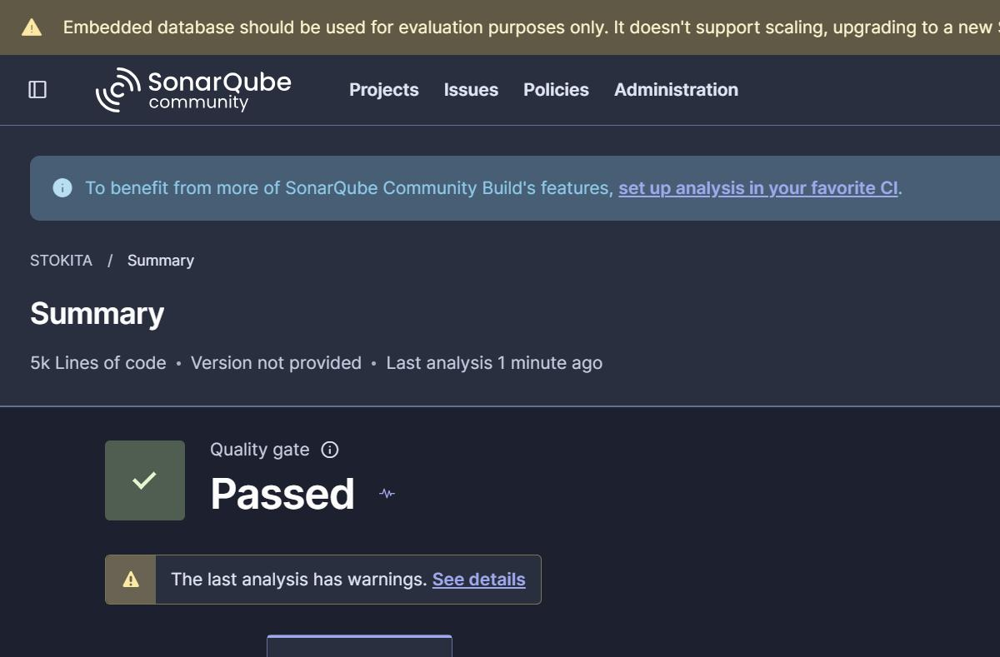
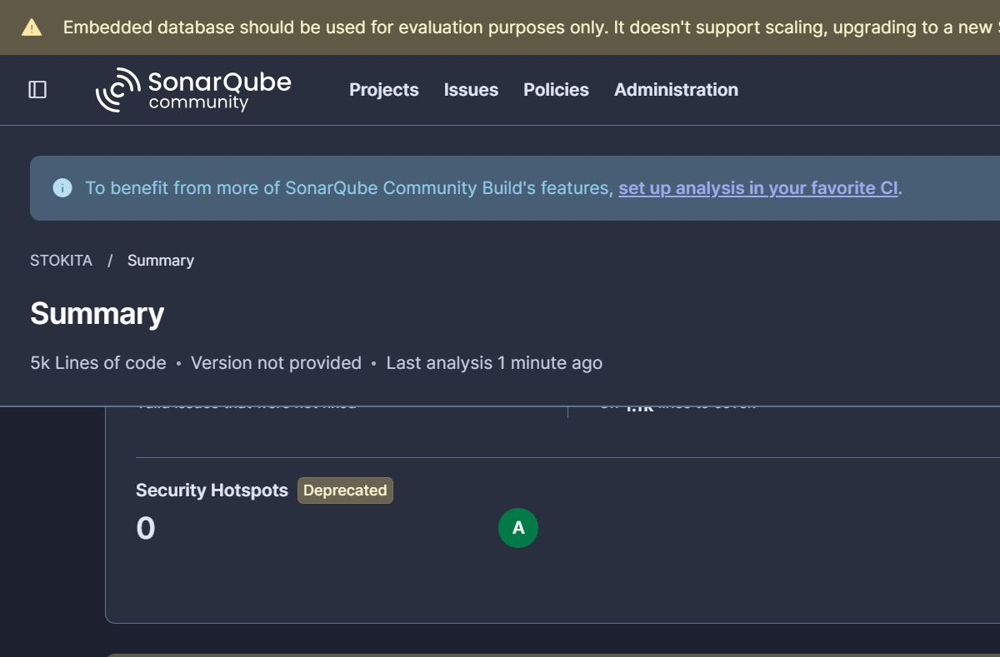
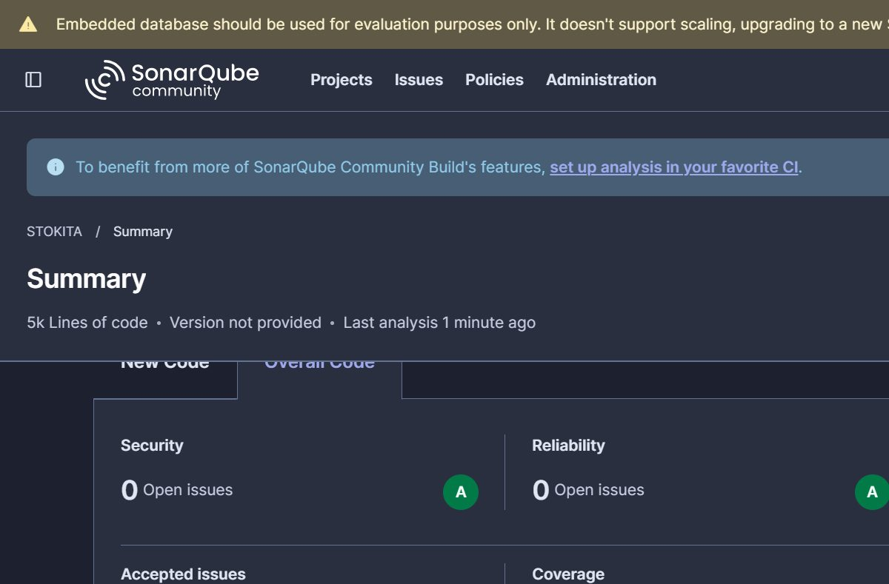
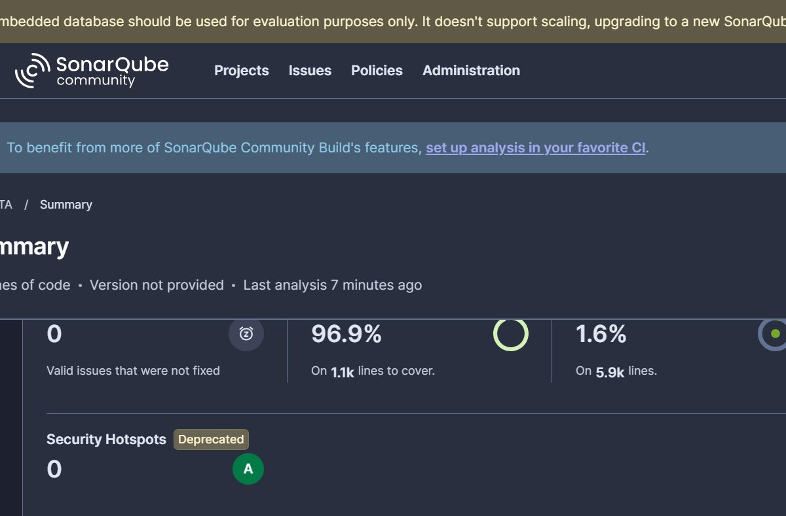

# Dokumen SonarQube Static Code Analysis — STOKITA

**Server:** SonarQube Community 26.11.0 (lokal, `http://localhost:9000`) · **Scanner:** SonarScanner CLI 8.3.1
**Konfigurasi:** `sonar-project.properties` · **Jalur:** `npm run sonar`
**Hasil:** **Quality Gate: Passed** · **Reliability A · Security A · Maintainability A** · **Coverage 96,9%** · **0 open issue**

---

## 1. Ringkasan Implementasi

Static code analysis diterapkan dengan **SonarQube Community Edition yang berjalan lokal**
(bukan SonarCloud maupun Docker), sehingga analisis bisa diulang sepenuhnya di mesin sendiri
tanpa dependensi layanan eksternal.

| Komponen | Versi / Lokasi | Keterangan |
| --- | --- | --- |
| SonarQube Server | Community 26.11.0 | Dijalankan dari ZIP lokal, `StartSonar.bat` |
| SonarScanner CLI | 8.3.1 (Windows x64) | Dijalankan via `sonar-scanner.bat` |
| Konfigurasi proyek | `sonar-project.properties` | projectKey `stokita`, host `localhost:9000` |
| Token analisis | Tipe `GLOBAL_ANALYSIS_TOKEN` | Disimpan di luar repo (jangan pernah di-commit) |
| Sumber coverage | `coverage/lcov.info` | Dihasilkan Vitest (`npm run test:coverage`) |

**Cara menjalankan analisis (reproduksi penuh):**

```powershell
# 1) nyalakan server SonarQube (sekali per sesi)
& "$env:USERPROFILE\Downloads\sonarqube-26.11.0.134175\sonarqube-26.11.0.134175\bin\windows-x86-64\StartSonar.bat"

# 2) jalankan test + coverage, lalu scan dalam satu perintah
npm run sonar
#    (setara dengan: vitest run --coverage && sonar-scanner)

# 3) buka hasil
#    http://localhost:9000/dashboard?id=stokita
```

> **Catatan penting:** `sonar.host.url` harus menunjuk ke server lokal. Tanpa itu,
> scanner 8.x bawaan mengarah ke SonarQube Cloud (`api.sonarcloud.io`) dan berhenti dengan
> `HTTP 403 Forbidden`. Nilai token juga dikirim lewat variabel lingkungan `SONAR_TOKEN`
> atau `-Dsonar.token=...` — tidak ditulis di `sonar-project.properties`.

---

## 2. Konfigurasi Analisis

```properties
sonar.host.url=http://localhost:9000          # server lokal, BUKAN SonarQube Cloud
sonar.projectKey=stokita
sonar.projectName=STOKITA

sonar.sources=src
sonar.exclusions=**/*.test.ts,**/*.test.tsx,**/test-utils/**
sonar.coverage.exclusions=**/*.test.ts,**/*.test.tsx,**/test-utils/**

sonar.javascript.lcov.reportPaths=coverage/lcov.info
sonar.typescript.lcov.reportPaths=coverage/lcov.info
```

- **File test & infrastruktur mock dikecualikan** dari analisis kode, tetapi hasil coverage-nya
  tetap masuk (melalui `lcov.info`) sehingga metrik Coverage merepresentasikan seluruh source code.
- Artefak scanner (`.scannerwork/`) masuk `.gitignore`.

---

## 3. Hasil Analisis

### 3.1 Quality Gate & Rating

| Penilaian | Hasil | Dasar ukur |
| --- | --- | --- |
| **Quality Gate** | ✅ **Passed** | Seluruh kondisi default terpenuhi |
| **Reliability** | ✅ **A** | `reliability_rating = 1.0`, **0 bug**, 0 open issue |
| **Security** | ✅ **A** | `security_rating = 1.0`, **0 vulnerability**, 0 hotspot |
| **Maintainability** | ✅ **A** | `sqale_rating = 1.0`, **0 code smell**, 0 accepted issue |
| **Coverage** | ✅ **96,9%** | jauh di atas ambang 80% (target opsional) |

### 3.2 Metrik Kuantitatif

| Metrik | Nilai | Keterangan |
| --- | --- | --- |
| Coverage (SonarQube) | **96,9%** | dihitung pada ±1,1 ribu baris ter-cover |
| Coverage (Vitest, statements) | **98,73%** (940/952) | `npm run test:coverage` |
| Duplications | **1,6%** | sangat rendah (ambang umum 3%) |
| Bugs | **0** | Reliability A |
| Vulnerabilities | **0** | Security A |
| Code smells | **0** | Maintainability A |
| Open issues | **0** | tidak ada temuan terbuka sama sekali |
| ncloc | **4.998** | baris kode TypeScript/TSX |

### 3.3 Unit Test yang Menopang Coverage

| Item | Nilai |
| --- | --- |
| File test | **66 file** (`src/**/*.test.{ts,tsx}`) |
| Kasus uji | **467 test — seluruhnya lulus** |
| Lint (`npm run lint`) | **0 error** |
| Typecheck (`npm run typecheck`) | **0 error** |

### 3.4 Bukti Layar

**Quality Gate Passed:**



**Overall Code — Security A & Reliability A (0 open issues):**



**Coverage 96,9% & Accepted issues 0:**



**Duplications 1,6% & Security Hotspots A:**



---

## 4. Satu Temuan yang Ditemukan & Diperbaiki

Analisis pertama menemukan **1 temuan** yang menurunkan rating Reliability di tampilan dashboard:

| Aturan | Severity | Lokasi | Impact |
| --- | --- | --- | --- |
| `typescript:S6848` | MAJOR | `src/components/confirm-dialog.tsx` baris 62–67 | RELIABILITY / MEDIUM |

**Masalah:** backdrop dialog konfirmasi dirender sebagai `<div>` biasa dengan handler
`onMouseDown` — elemen non-native yang bersifat interaktif tanpa `role` maupun dukungan
keyboard (pelanggaran aksesibilitas yang oleh SonarQube berdampak ke Reliability).

**Perbaikan:** backdrop dipisah menjadi elemen `<button type="button" aria-label="Tutup dialog">`
sebagai saudara dari `role="dialog"` (tidak boleh menaruh tombol di dalam tombol), ditambah CSS
`.confirm-backdrop` serta `position: relative; z-index: 1` pada `.confirm-dialog` agar isi dialog
tetap berada di atas backdrop. Test `confirm-dialog.test.tsx` disesuaikan ke interaksi klik tombol.

**Hasil setelah analisis ulang:** seluruh temuan **0** → Reliability **A**, Maintainability **A**,
Security **A**, Quality Gate tetap **Passed**.

---

## 5. Pemetaan ke Kriteria Penilaian

| Kriteria | Status | Bukti |
| --- | --- | --- |
| Unit Test (Wajib) | ✅ | 66 file / 467 test lulus, `npm test` |
| Linter (Wajib) | ✅ | `npm run lint` → 0 error, 0 warning |
| Integration Testing (Playwright) | ✅ | 14 file BDD `tests/e2e`, PR #2 (merged) |
| SonarQube (Wajib) | ✅ | Dokumen ini + dashboard `localhost:9000` |
| Reliability A | ✅ | `reliability_rating = 1.0`, 0 bug |
| Maintainability A | ✅ | `sqale_rating = 1.0`, 0 code smell |
| Security A | ✅ | `security_rating = 1.0`, 0 vulnerability |
| Coverage ≥ 80% (opsional) | ✅ | **96,9%** (SonarQube) / 98,73% (Vitest) |
