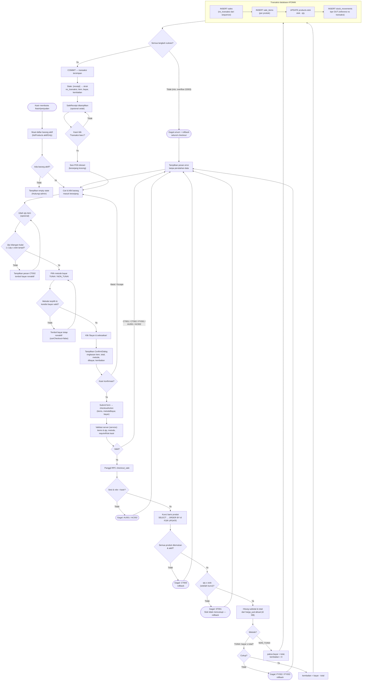

# Activity Diagram — Proses Penjualan

**Tujuan diagram:** memetakan alur aktivitas penjualan kasir dari persiapan
keranjang sampai struk, termasuk seluruh percabangan kondisi gagal (input
tidak valid, metode/bayar tidak valid, barang nonaktif, stok tidak
mencukupi, transaksi gagal) berdasarkan implementasi
`sale-terminal.tsx`, `checkoutAction`, dan fungsi `checkout_sale`.

**Sintaks:** Mermaid `flowchart TD`. Simbol belah ketupat = keputusan;
labeled edge = hasil percabangan.

**Penjelasan percabangan:**

| Titik keputusan | Kondisi | Hasil |
| --- | --- | --- |
| Qty | bukan bilangan bulat > 0 atau melebihi stok tampil | pesan `CT002`, tombol bayar nonaktif |
| Metode/bayar | metode belum dipilih; TUNAI dengan bayar < total | `canCheckout = false` di klien; di server `PY001–PY003` |
| Konfirmasi | kasir membatalkan dialog | kembali ke POS tanpa request |
| Validasi service | input tidak valid / sesi-role salah | pesan error, tanpa panggilan RPC |
| Setelah kunci baris | barang hilang/nonaktif | `CT003`, rollback |
| Setelah kunci baris | qty > stok aktual | `ST001`, rollback |
| Pembayaran | TUNAI bayar kurang | `PY002/PY003`, rollback |
| Saat menulis | kegagalan apa pun (termasuk overflow `22003`) | rollback seluruh checkout — tidak ada stok terpotong tanpa nota |
| Sukses | seluruh langkah selesai | commit → struk → opsi transaksi baru |

Catatan: perhitungan tampilan total/kembalian di klien
(`calculateTotal`/`calculateChange`) **hanya untuk UI** — nilai yang
disimpan selalu hasil hitung fungsi database.

Terkait: [Sequence Penjualan](sequence-penjualan.md),
[Use Case dan Alur](../USE_CASE_AND_FLOW.md#44-penjualan-oleh-kasir-pos),
[Database dan State](../DATABASE_AND_STATE.md).
