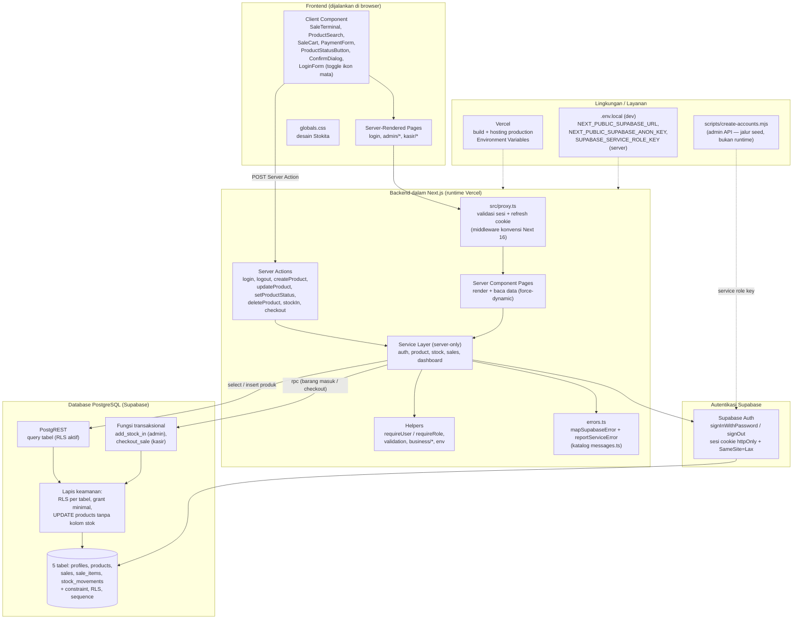
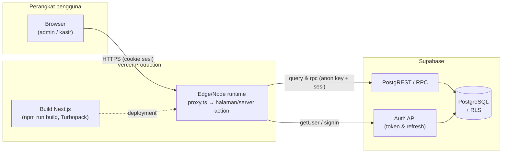

# Diagram Arsitektur Sistem STOKITA

**Tujuan diagram:** memperlihatkan komponen sistem Stokita — frontend
(halaman & komponen klien), backend (Server Component, Server Action,
service), autentikasi, database, dan layanan eksternal — beserta arah
komunikasinya, sesuai struktur kode yang ada (Next.js App Router +
Supabase + Vercel).

**Dua tampilan:**

1. **Diagram komponen** (diagram 1) — satuan fungsional aplikasi dan
   dependensinya.
2. **Diagram deployment/arsitektur runtime** (diagram 2) — bagaimana
   komponen tersebut dipasang pada Vercel dan Supabase.

**Diagram runtime (deploy):**

**Penjelasan alur komponen:**

1. **Permintaan masuk** → `proxy.ts` memvalidasi sesi (dan me-refresh
   cookie) → Server Component merender halaman, memanggil service untuk
   membaca data → HTML + payload RSC dikirim ke browser.
2. **Interaksi pengguna** (submit form, checkout, toggle status) → POST
   Server Action → service memvalidasi input & otorisasi → PostgREST
   (CRUD produk) atau RPC (`add_stock_in`, `checkout_sale`) → state
   hasil/redirect → UI menyegarkan data dari server.
3. **Autentikasi** sepenuhnya di Supabase Auth; aplikasi hanya memakai
   sesi cookie dan membaca profil `profiles` — tanpa sesi publik/registrasi.
4. **Keamanan data** berada di database: RLS + grant minimal + fungsi
   SECURITY DEFINER; anon key yang ada di browser tidak cukup untuk
   menembus aturan tersebut.
5. **Operasional**: build & runtime di Vercel dengan environment variables
   produksi; pembuatan akun awal memakai service role key **hanya** di
   script lokal seed (tidak pernah mengalir ke browser).

Keterangan lebih lanjut: [Arsitektur Sistem](../ARCHITECTURE.md),
[API dan Keamanan](../API_AND_SECURITY.md),
[Deployment dan Operasional](../DEPLOYMENT_AND_OPERATIONS.md).
