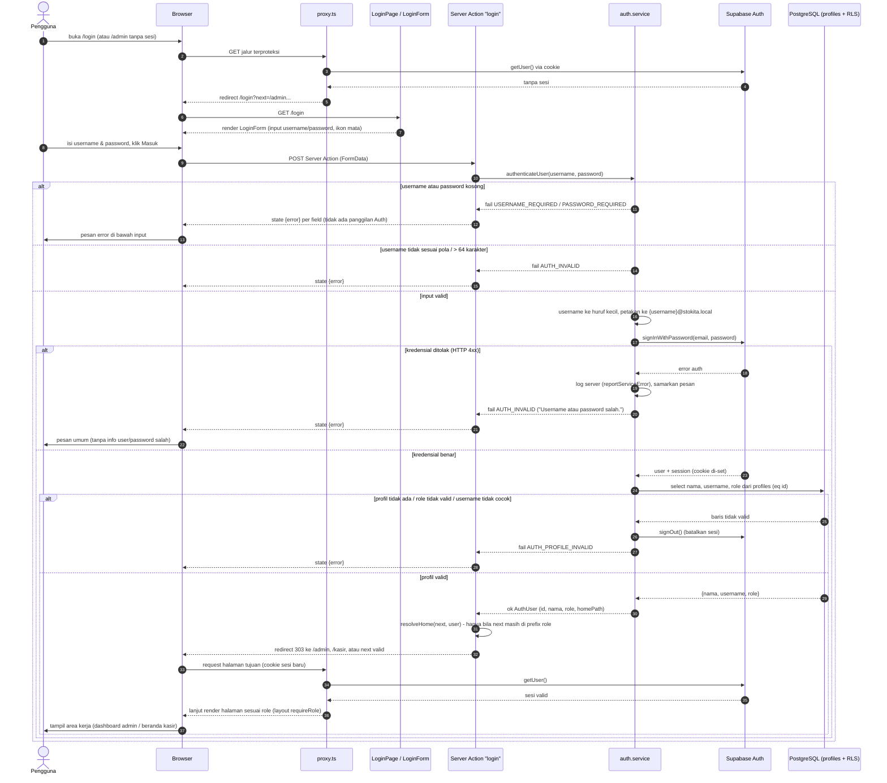

# Sequence Diagram — Login

**Tujuan diagram:** memvisualisasikan proses login Stokita dari pengiriman
form hingga validasi kredensial, pemeriksaan profil/role, penetapan tujuan
redirect, termasuk cabang gagal — sesuai alur di
`src/app/actions/auth.actions.ts` → `src/services/auth.service.ts` →
Supabase Auth, serta proteksi sesi oleh `src/proxy.ts`.

**Alur ringkas:** form login → Server Action `login` → validasi input →
username dipetakan ke email internal → `signInWithPassword` → baca baris
`profiles` → role & username cocok → redirect ke home role (atau `next`
yang masih dalam prefix role). Kegagalan apa pun menghasilkan pesan umum
tanpa membocorkan penyebab.

**Penjelasan langkah penting:**

1. **Proteksi terjadi sebelum halaman** — `proxy.ts` me-refresh cookie dan
   mengarahkan pengguna tanpa sesi ke `/login?next=…`; parameter `next`
   dipakai lagi saat login.
2. **Validasi dua tahap** — format input dulu (tanpa panggilan Auth), baru
   `signInWithPassword`; kegagalan Auth 4xx disamarkan menjadi satu pesan
   umum agar tidak membocorkan keberadaan akun.
3. **Profil adalah gerbang role** — sesi Auth saja tidak cukup; baris
   `profiles` harus ada, role harus `admin|kasir`, dan username harus cocok;
   jika tidak, sesi langsung diakhiri (`signOut`).
4. **Redirect aman** — `next` hanya diterima bila masih dalam prefix role
   sendiri (`/admin…` untuk admin, `/kasir…` untuk kasir), selain itu ke
   home role (`homePathForRole`).
5. **Sesi berikutnya** kembali diverifikasi `proxy.ts` + layout
   `requireRole` — kegagalan role menghasilkan halaman akses ditolak, bukan
   konten.

**Cabang gagal yang tidak ditampilkan agar tetap ringkas:** jaringan
error saat memanggil Auth (dipetakan `LOGIN_FAILED` — "Login gagal. Silakan
coba lagi.") dan penolakan layout halaman (`requireRole` → `AccessDenied`).

Terkait: [Use Case](use-case.md),
[API dan Keamanan](../API_AND_SECURITY.md#1-autentikasi-dan-logout).
