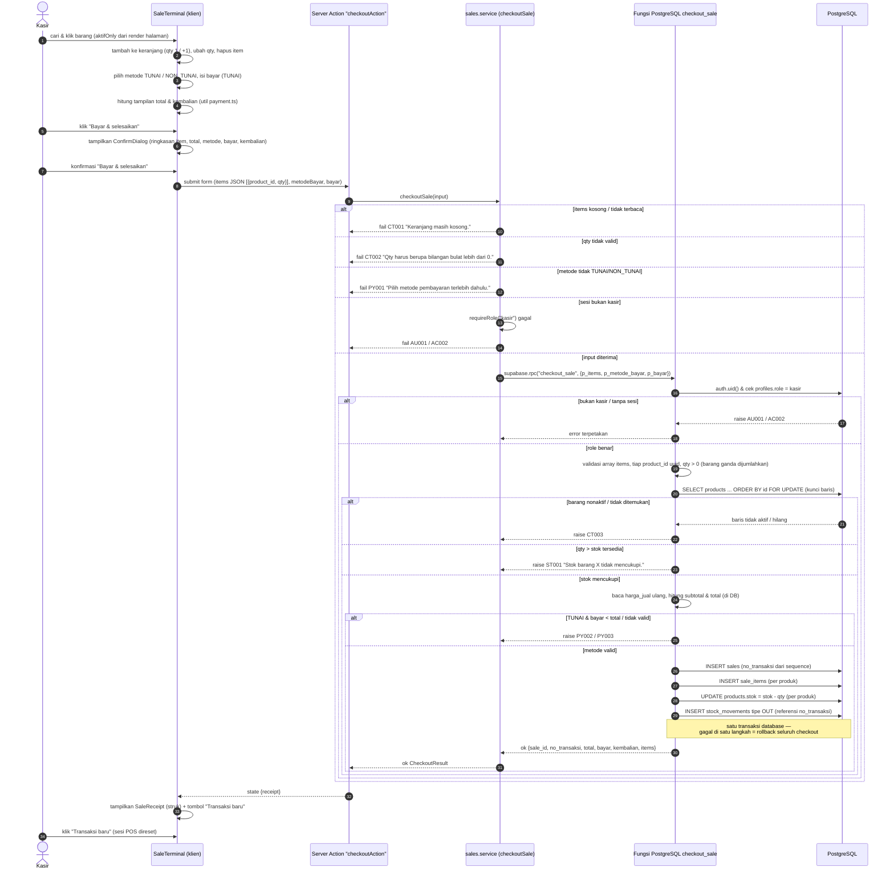

# Sequence Diagram — Penjualan (Checkout Kasir)

**Tujuan diagram:** memvisualisasikan proses penjualan dari sisi kasir:
penyusunan keranjang di klien, validasi input, Server Action, service,
panggilan fungsi PostgreSQL `checkout_sale`, pemeriksaan stok & pembayaran,
penyimpanan transaksi atomik, hingga tampilan struk — sesuai kode
`src/app/kasir/penjualan/` dan `supabase/migrations/005_checkout_sale.sql`.

**Catatan:** transaksi database (INSERT `sales`/`sale_items`, UPDATE
`products.stok`, INSERT `stock_movements`) dilakukan **di dalam satu
fungsi RPC** `checkout_sale` — bukan beberapa panggilan terpisah dari
aplikasi. Inilah alur "transaksi database" yang dipakai Stokita.

**Penjelasan langkah penting:**

1. **Klien tidak dipercaya untuk nilai uang.** Form hanya membawa
   `product_id` + `qty` + metode + nominal tunai. Harga, stok, total,
   bayar akhir, dan kembalian dihitung/divalidasi ulang di dalam fungsi
   database (harga diambil ulang dari baris yang terkunci).
2. **Penguncian baris (`FOR UPDATE`) dengan urutan `id`** menyerialisasi
   dua kasir yang menjual produk sama; stok diperiksa **setelah** kunci
   dipegang sehingga tidak ada cek-terus-pakai yang basi (race condition).
3. **Atomik penuh** — `sales` + `sale_items` + pengurangan stok + mutasi
   `OUT` terjadi dalam satu transaksi database; kegagalan di titik mana pun
   (stok kurang, bayar kurang, overflow) membatalkan semuanya sehingga tidak
   pernah ada stok terpotong tanpa nota.
4. **Hasil sukses berupa objek struk lengkap** yang dikembalikan RPC lalu
   dirender sebagai struk digital; nomor transaksi `TRX-YYYYMMDD-NNNNNN`
   dibangkitkan atomik dari sequence.
5. **Gagal = tanpa efek samping.** Pesan error dipetakan dari kode kustom
   (`CT001…ST001`, `PY001–003`) ke katalog pesan aplikasi dan tampil di
   POS; keranjang tetap utuh untuk diperbaiki kasir.

Terkait: [Activity Penjualan](activity-penjualan.md),
[Sequence Penjualan lebih dari fungsi DB](../DATABASE_AND_STATE.md#6-konsistensi-data-dan-transaksi),
[Use Case](use-case.md).
