# Use Case STOKITA

**Tujuan diagram:** memetakan aktor (admin, kasir) terhadap use case
aplikasi serta hubungan antar use case-nya, berdasarkan fitur yang benar-benar
diimplementasikan di kode.

**Catatan representasi:** diagram dirender memakai sintaks Mermaid
`flowchart` (dipilih agar andal tampil di GitHub) dengan simpul aktor
(`((…))`), grup use case per area, dan panah putus-putus untuk hubungan
`<<include>>` / `<<extend>>`. Definisi use case (prasyarat & hasil) ada di
[USE_CASE_AND_FLOW.md](../USE_CASE_AND_FLOW.md).

```mermaid
flowchart TD
    Admin(("Admin"))
    Kasir(("Kasir"))
    Publik(("Pengguna<br/>tanpa sesi"))

    subgraph AUTH["Autentikasi"]
        UC1["UC-A1 / UC-K1<br/>Login (username + password)"]
        UC2["UC-A15 / UC-K9<br/>Logout (konfirmasi)"]
    end

    subgraph AREA_A["Area Admin — /admin"]
        UC3["UC-A2<br/>Melihat dashboard"]
        UC4["UC-A3<br/>Melihat & mencari barang"]
        UC5["UC-A4<br/>Menambah barang"]
        UC6["UC-A5<br/>Mengubah data barang"]
        UC7["UC-A6<br/>Menonaktifkan barang<br/>(dialog konfirmasi)"]
        UC8["UC-A7<br/>Mengaktifkan barang<br/>(dialog konfirmasi)"]
        UC9["UC-A8<br/>Menghapus barang permanen<br/>(dialog konfirmasi)"]
        UC10["UC-A9<br/>Mencatat barang masuk"]
        UC11["UC-A10<br/>Riwayat barang masuk"]
        UC12["UC-A11<br/>Monitoring stok menipis/habis"]
        UC13["UC-A12<br/>Riwayat pergerakan stok"]
        UC14["UC-A13<br/>Riwayat penjualan semua kasir"]
        UC15["UC-A14<br/>Detail transaksi (admin)"]
    end

    subgraph AREA_K["Area Kasir — /kasir"]
        UC16["UC-K2<br/>Cari & pilih barang aktif"]
        UC17["UC-K3<br/>Ubah/hapus item keranjang"]
        UC18["UC-K4<br/>Pilih metode & nominal bayar"]
        UC19["UC-K5<br/>Konfirmasi & selesaikan penjualan"]
        UC20["UC-K6<br/>Transaksi baru"]
        UC21["UC-K7<br/>Riwayat penjualan sendiri"]
        UC22["UC-K8<br/>Detail transaksi sendiri"]
    end

    Sistem(("Supabase<br/>Auth + PostgreSQL<br/>(RLS & fungsi transaksi)"))

    Publik --> UC1
    Admin --> UC1
    Kasir --> UC1
    Admin --> UC2
    Kasir --> UC2

    Admin --> UC3
    Admin --> UC4
    Admin --> UC5
    Admin --> UC6
    Admin --> UC7
    Admin --> UC8
    Admin --> UC9
    Admin --> UC10
    Admin --> UC11
    Admin --> UC12
    Admin --> UC13
    Admin --> UC14
    Admin --> UC15

    Kasir --> UC16
    Kasir --> UC17
    Kasir --> UC18
    Kasir --> UC19
    Kasir --> UC20
    Kasir --> UC21
    Kasir --> UC22

    UC5 -. "«include»" .-> UC4
    UC6 -. "«include»" .-> UC4
    UC7 -. "«include»" .-> UC4
    UC8 -. "«include»" .-> UC4
    UC9 -. "«include»" .-> UC4
    UC9 -. "«extend» bila punya riwayat" .-> UC7
    UC16 -. "«include»" .-> UC19
    UC17 -. "«include»" .-> UC19
    UC18 -. "«include»" .-> UC19
    UC19 -. "«extend» setelah sukses" .-> UC20

    UC1 -.-> Sistem
    UC19 -.-> Sistem
    UC10 -.-> Sistem
```

**Penjelasan alur singkat:**

1. Semua aktor masuk lewat **Login** (tanpa sesi hanya sampai halaman login;
   rute terproteksi otomatis diarahkan `proxy.ts`).
2. Admin: daftar barang (**UC-A3**) menjadi titik masuk operasi
   tambah/edit/nonaktifkan/aktifkan/hapus (`«include»`). Bila **hapus**
   gagal karena barang punya riwayat, sistem menyarankan
   **nonaktifkan** (`«extend»`).
3. Kasir: memilih barang → keranjang → pembayaran menyatu dalam
   **selesaikan penjualan** (`«include»`); struk membuka opsi
   **transaksi baru** (`«extend»`).
4. Seluruh aksi tulis berinteraksi dengan **Supabase** (RLS untuk CRUD
   barang; fungsi transaksi `add_stock_in` / `checkout_sale` untuk stok &
   penjualan) — bukan sekadar lapisan tampilan.

Terkait: [Sequence Login](sequence-login.md),
[Sequence Penjualan](sequence-penjualan.md),
[Use Case dan Alur](../USE_CASE_AND_FLOW.md).
